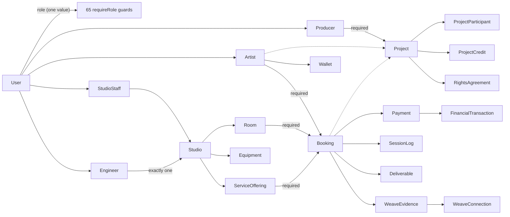
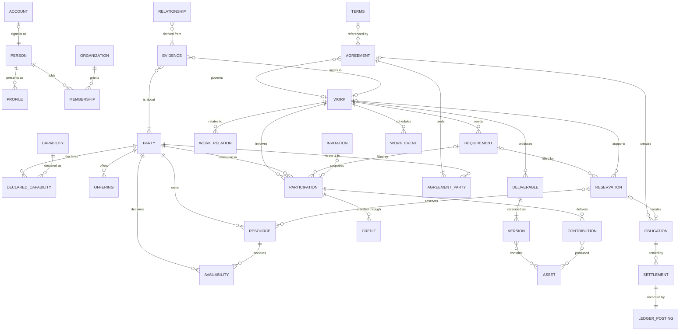
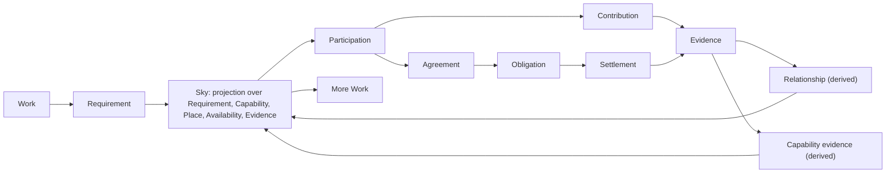

# OIANO CANONICAL ARCHITECTURE V1 — REPOSITORY RECONCILIATION REPORT

> **Status: evidence and proposals for an owner decision. Canonical Architecture V1 is not frozen.**
> Nothing described as a proposal exists. No production code, schema, migration or database was
> changed to produce this report.
>
> Measured on `main` at `682d052`, clean working tree, on 2026-09-14. The
> [frozen architecture](OIANO_FROZEN_ARCHITECTURE.md) and its owner decisions of 2026-09-12 still
> govern until the owner amends them. This report tests that architecture and the Canonical V1
> brief against the repository and against each other.

## How to read this report

| Label | Meaning |
|---|---|
| **FACT** | Verified in the repository at `682d052`. Read in the code unless a test run or command output is cited. |
| **INFERENCE** | A conclusion drawn from facts. It can be wrong; where it matters, the report says what would confirm it. |
| **PROPOSAL** | Recommended future architecture. It does not exist. |
| **OWNER DECISION** | Cannot be settled from code alone. |

Citation shorthand: `schema:N` is `prisma/schema.prisma` line N; `api/…` is `apps/api/src/…`;
`web/…` is `apps/web/src/…`; every other path is relative to the repository root. Ranges are
inclusive line numbers at `682d052`.

Documents this report reconciles against: [frozen architecture](OIANO_FROZEN_ARCHITECTURE.md),
[architecture delta](OIANO_ARCHITECTURE_DELTA.md), [schema redesign](OIANO_SCHEMA_REDESIGN.md),
[build direction](OIANO_BUILD_DIRECTION.md), [stabilization gate](OIANO_STABILIZATION_GATE.md),
[implementation status](OIANO_IMPLEMENTATION_STATUS.md),
[architecture audit](ARCHITECTURE_AUDIT_2026_09_06.md), [direction](OIANO_DIRECTION.md) and
[experience mismatch](OIANO_EXPERIENCE_MISMATCH_2026_09_13.md).

---

## Contents

1. [Executive Summary](#1-executive-summary)
2. [Current Architecture Map](#2-current-architecture-map)
3. [Current Product Capabilities](#3-current-product-capabilities)
4. [Candidate Canonical Vocabulary](#4-candidate-canonical-vocabulary)
5. [Canonical Entity Definitions](#5-canonical-entity-definitions)
6. [Relationship Map](#6-relationship-map)
7. [Proposed Architectural Laws](#7-proposed-architectural-laws)
8. [Contradictions Found](#8-contradictions-found)
9. [Complection Analysis](#9-complection-analysis)
10. [Identity & Capability Analysis](#10-identity--capability-analysis)
11. [Organization & Resource Analysis](#11-organization--resource-analysis)
12. [Work / Requirement / Participation / Contribution Analysis](#12-work--requirement--participation--contribution-analysis)
13. [Evidence / Passport / Trust Analysis](#13-evidence--passport--trust-analysis)
14. [Agreement / Transaction Analysis](#14-agreement--transaction-analysis)
15. [Weave / Relationship Analysis](#15-weave--relationship-analysis)
16. [Sky / Discovery Implications](#16-sky--discovery-implications)
17. [AI Boundary](#17-ai-boundary)
18. [Permissions / Privacy Implications](#18-permissions--privacy-implications)
19. [State Machines](#19-state-machines)
20. [Canonical Invariants](#20-canonical-invariants)
21. [Scenario Pressure-Test Results](#21-scenario-pressure-test-results)
22. [Golden Journey — Current Coverage](#22-golden-journey--current-coverage)
23. [Existing Model KEEP / ADAPT / MIGRATE / MERGE / SPLIT / RETIRE Matrix](#23-existing-model-keep--adapt--migrate--merge--split--retire-matrix)
24. [Verification Infrastructure Audit](#24-verification-infrastructure-audit)
25. [Proposed Verification System Architecture](#25-proposed-verification-system-architecture)
26. [World Simulator Design](#26-world-simulator-design)
27. [Launch Reliability Requirements](#27-launch-reliability-requirements)
28. [Rewrite vs Migration Decision](#28-rewrite-vs-migration-decision)
29. [Migration Dependency Graph](#29-migration-dependency-graph)
30. [Proposed Numbered Migration Order](#30-proposed-numbered-migration-order)
31. [Explicitly Rejected Architectural Alternatives](#31-explicitly-rejected-architectural-alternatives)
32. [Unresolved Owner Decisions](#32-unresolved-owner-decisions)
33. [Risks Before Canonical Freeze](#33-risks-before-canonical-freeze)
34. [Exact Criteria Required to Declare "CANONICAL ARCHITECTURE V1 — FROZEN"](#34-exact-criteria-required-to-declare-canonical-architecture-v1--frozen)
35. [Final Questions](#35-final-questions)

---

## 1. Executive Summary

### The answer in one paragraph

**INFERENCE.** The Canonical V1 direction is right, and the repository shows why. Almost every
limitation found traces to three fused concepts: **account = identity = authority** (one
`User.role` column decides who someone is and what they may do), **organization = studio =
place = commerce** (the only organization is a Studio row that also carries its address,
currency, Stripe account and a legacy passport mint), and **work = a producer-owned music
project whose proof hangs off a booked room**. The thesis's primitives survive the repository and
all 30 scenarios with five corrections, and no scenario needs a profession-specific table. The
existing codebase is not a liability to discard: its balanced ledger, booking transition guard,
database overlap constraint, idempotency keys, evidence-derived Weave and real-Postgres
integration suite are the invariant-holding machinery Canonical V1 needs. The recommendation is
the strangler migration already frozen, amended in eight places (§28, §30). **Canonical V1 cannot
be declared frozen today** (§34).

### The seven findings that matter most

1. **Identity, role and authority are one column.** **FACT:** `User.role` is a single enum value
   (`schema:15-21`, `schema:140`), reloaded on every request (`api/middleware/auth.middleware.ts:14-22`)
   and checked by 65 `requireRole` guards in 17 route modules. No code path changes a user's role
   after signup: every `user.update` touches only the active studio, MFA or password
   (`api/middleware/studioScope.middleware.ts:40`, `api/routes/studio.routes.ts:91,203`,
   `api/controllers/auth.controller.ts:83,242,387-389`). Accepting a studio staff invitation
   creates a membership but leaves the account role unchanged (`api/routes/studio.routes.ts:200-205`),
   and an integration test states that a membership alone does not make a producer staff
   (`api/integration/bookings-payments.integration.test.ts:349-352`). **INFERENCE:** a person
   who is an artist, a producer, a photographer and a studio owner needs three logins and three
   email addresses today (`schema:137` unique email; `api/lib/studioOnboarding.ts:51-77` creates a
   new login for every studio).
2. **Capability is code, not data.** **FACT:** twelve disciplines are hard-coded
   (`api/controllers/auth.controller.ts:27-36`, `web/lib/creativeDisciplines.ts:1-14`) and stored
   only for producers (`schema:829-830`); engineers have free-text specialties (`schema:354`);
   artists have a `creative_dna` JSON blob (`schema:460`); participants, credits and the
   completion screen use three different role vocabularies
   (`api/routes/producer.routes.ts:194,257`, `api/controllers/bookings/complete-session.controller.ts:22-25`).
   The word "capability" already means a staff permission (`schema:238`,
   `api/routes/studio.routes.ts:144-148`). Every new profession is a code change and a deploy.
3. **The only organization is a Studio, and a self-registered studio cannot operate.** **FACT:**
   registering a studio creates a new login (`api/lib/studioOnboarding.ts:51-77`). No API route
   creates or edits rooms, services, engineers or availability, and a studio row is otherwise
   written only when its Stripe account is set (`api/routes/payouts.routes.ts:80`). A booking
   requires a room and a service (`api/controllers/bookings.controller.ts:359-362`).
   **INFERENCE:** a studio that registers itself cannot take its first booking without someone
   editing the database.
4. **Work cannot start with the person doing it.** **FACT:** `Project.producer_id` is required
   (`schema:882-883`) and only a PRODUCER account can create a project
   (`api/routes/producer.routes.ts:354-374`). Deliverables, session logs, Weave evidence and
   payments all require a booking (`schema:674,723,766,1336`); a booking requires an artist and a
   room (`schema:561-564`). There is no Requirement anywhere in the schema.
5. **Proof and standing are partly claims.** **FACT:** evidence comes only from completed bookings
   (`api/lib/weave/sync.ts:49-117`). Artist tier is gated on a stored completeness score
   (`api/lib/artistTier.ts:25`) and promoted by replies to direct messages, which auto-accept a
   connection (`api/routes/connect.routes.ts:188-194` with `api/lib/artistTier.ts:36-37,70-77`).
   An engineer's confirmed credits are matched by name (`api/routes/network-metrics.routes.ts:62`).
   A confirmed credit can be hard-deleted by the producer (`api/routes/producer.routes.ts:287-296`).
6. **Defects found in passing that should not wait for the migration.** All are read in the code,
   not executed; §8 gives each in full.
   - Any signed-in account can read another artist's recent session logs, including notes and
     ratings, and a location the artist chose to keep private (`api/routes/artists.routes.ts:118-166`).
   - A private AI brief is served for any artist to any signed-in account, and regenerated outside
     the AI feature flag (`api/routes/artists.routes.ts:173-207`, `api/services/ai-summary.service.ts:16-53`).
   - A studio operator can credit up to $10,000 per request to the wallet of any artist who has
     booked there, with no permission check beyond the account role and no ledger posting; the
     credit is spendable at every studio (`api/routes/admin.routes.ts:176-205`).
   - Rescheduling can lengthen a paid session without re-pricing it
     (`api/controllers/bookings/session-management.controller.ts:82-86`).
   - **INFERENCE:** two concurrent payout requests can both reserve the same balance
     (`api/lib/studioPayout.ts:73-119` has no lock and runs at default isolation).
   - The load test's live-stream scenario cannot authenticate, so it has never measured anything
     (`apps/api/scripts/load-test.js:84-103` against `api/routes/notifications.routes.ts:45-58`).
7. **Verification cannot yet attack invariants automatically.** **FACT:** 16 API unit test files,
   5 intelligence test files, 5 integration files holding 39 tests on real Postgres
   (`docs/OIANO_IMPLEMENTATION_STATUS.md:203`), and 9 web test files. There is no property-based,
   model-based, browser, simulation, chaos or automated mutation testing; the load test has never
   been run; the development seed writes states the application cannot reach
   (`prisma/seed-ecosystem.ts:192-203,217,220`).

### Verdict on the candidate primitives

| Candidate | Verdict | Correction | Section |
|---|---|---|---|
| Person | Survives | Separate from User (login) and from any role | §10 |
| Capability | Survives | Rename today's staff "capabilities" to permissions; capabilities are data, not an enum | §10 |
| Organization | Survives | Any kind, not only studios; created by an existing Person | §11 |
| Resource | Survives | Absorbs CreativeSpace; owned by a Person or an Organization; a Person is never a Resource | §11 |
| Work | Survives | Startable by anyone; open kinds; related Works (a video for a song) | §12 |
| Requirement | Survives | Needs a quantity ("two models") and several fills | §12 |
| Participation | Survives | Amends the frozen architecture, which has only Contribution | §12 |
| Contribution | Survives, narrower | What was delivered, not membership in the Work | §12 |
| Evidence | Survives | Multi-source provenance, retraction instead of deletion, strength tiers | §13 |
| Agreement | Survives | Standing Terms (studio policies) kept separate from consent records | §14 |
| Transaction | **Does not survive as a canonical term** | Obligation + Settlement, with the ledger internal; the name collides with `FinancialTransaction` | §14 |
| Relationship | Survives as a projection only | Derived from Evidence; follows and message requests are Contacts | §15 |
| Place | Survives as a value, not a table | A place that is owned or booked is a Resource of kind LOCATION | §11 |
| Availability | Survives, split | Declared availability (a fact) versus occupancy (a projection) | §11 |

Required but absent from the candidate list: **Membership**, **Credit**, **Reservation** (today's
Booking), **WorkEvent**, **Asset / Deliverable / Version**, **Terms**, **Offering**, **Invitation**,
and the abstract **Party** (Person or Organization) that owns, agrees, owes and is paid (§4).

### Verdict on the laws, the journey and the scenarios

- **Laws:** all eleven proposed laws survive. Four need sharper wording and nine are added (§7).
- **Golden Journey V1 today:** 0 of 25 steps work now; 7 partially work; 9 exist in the wrong
  model; 7 are missing; 2 are blocked by the architecture (§22).
- **Scenarios under the candidate model:** 21 of 30 fit, 9 fit with one of five shared extensions
  (Work relations, engagement through an organization, resource units, credentials, grouping),
  and none fail. Under today's model 1 works, 4 partially, 5 only through a workaround, and 20
  cannot be represented (§21).

### Recommendation and freeze status

**PROPOSAL.** Option C, the strangler migration, amended: a verification foundation before step
1; contextual authorization as an explicit early step; Capability replaces Discipline;
CreativeProfile becomes presentation only, with history attached to the Person; Participation is
split from Contribution; Resource, Place and Availability replace CreativeSpace; Terms are kept
apart from Agreement; and Obligation and Settlement replace "Transaction" (§28, §30).

**Not frozen.** Freezing needs owner decisions OD-01 to OD-08 (§32), the stabilization gate
passed with gate 2 merged, every contradiction in §8 given a disposition, the defects in finding 6
fixed or scheduled, and a verification foundation able to attack the first invariants (§34).

---

## 2. Current Architecture Map

### 2.1 Deployment and runtime

| Element | Current state | Label and evidence |
|---|---|---|
| API service | Render web service `oiano-api`, `plan: free` (spins down after 15 idle minutes), region oregon, single instance | **FACT** `render.yaml:21-38` |
| Environment | `NODE_ENV=staging`, so the production readiness checks in `env.ts` do not run | **FACT** `render.yaml:40-47`; `api/lib/env.ts:22-58` |
| Migrations | Applied by hand; `main` auto-deploys | **FACT** `render.yaml:16-19`; `AGENTS.md` rule 2 |
| Web | Static SPA `oiano-web` with rewrite to `index.html` | **FACT** `render.yaml:85-98` |
| Database | PostgreSQL through Prisma 5.22, pool limit 20; the code comments name Neon | **FACT** `api/lib/prisma.ts:20-49` |
| External services | Stripe (disabled), Anthropic (flag off), Cloudflare R2, SendGrid, Sentry | **FACT** `render.yaml:60-83`; `api/lib/env.ts:12-20,43-49` |
| Process-local state | Live-stream registry, rate-limit counters, pulse cache, activity event bus | **FACT** §2.6 |

### 2.2 Code layout

| Area | Contents | Evidence |
|---|---|---|
| `apps/api` | Express 4, Prisma, Zod. 36 route modules; controllers only for auth and bookings; domain helpers in `lib/`; `services/` for live updates, email, AI brief, studio circle; `intelligence/` for flag-gated AI | **FACT** `api/app.ts:13-48`; directory listing |
| `apps/web` | React 18, Vite, React Query, Zustand; 50 pages; role-gated routes | **FACT** `web/App.tsx:18-182` |
| `packages/shared` | `SINGLE_STUDIO_MODE=false`, `DEFAULT_STUDIO_SLUG='dreamz-music-lab'`, a documentation-only geo shape | **FACT** `packages/shared/src/constants.ts:2-3`; `packages/shared/src/geo.ts:3-37` |
| `prisma` | 58 models, 20 tracked migrations, two seeds, a Weave backfill | **FACT** `schema:1-1400`; `prisma/migrations/*`; `prisma/seed.ts`; `prisma/seed-ecosystem.ts`; `prisma/backfill-weave.ts` |
| `scripts` | Local disposable Postgres, integration runner, secret scan, readiness and baseline checks, dev triggers | **FACT** `package.json:8-33` |

### 2.3 Request path

**FACT.** `requestId` → `accessLog` → `helmet` → `cors` → a global limit of 300 requests per minute
per IP → public `/uploads` → raw body for `/api/webhooks` → JSON → `/health` → 36 routers → error
handler (`api/app.ts:69-167`). Authentication verifies the JWT, then reloads the role and
`auth_version` from the database (`api/middleware/auth.middleware.ts:7-27`). Studio scope comes
from `User.active_studio_id` and a `StudioStaff` membership
(`api/middleware/studioScope.middleware.ts:11-42`). Most domain logic lives inside route handlers
(for example `api/routes/producer.routes.ts`), with shared rules lifted into `api/lib/` where
defects forced it (`api/lib/bookingTransitions.ts`, `api/lib/rightsDecision.ts`,
`api/lib/financialLedger.ts`, `api/lib/weave/sync.ts`).

### 2.4 Domain clusters

| Cluster | Models (line ranges) |
|---|---|
| Account and identity | User `schema:135-169` · Artist `400-429` · Producer `817-838` · Engineer `342-364` · ArtistPassport `455-483` · ProducerPassport `840-853` · PassportView `485-496` · AdminAuditLog `171-188` |
| Organization and resources | Studio `192-228` · StudioStaff `230-248` · StudioStaffInvitation `250-268` · Room `270-286` · Equipment `291-310` · MaintenanceIssue `312-340` · ServiceOffering `366-379` · AvailabilitySlot `381-396` · StudioPolicy `603-628` · PolicyException `630-658` · StudioAnnouncement `1066-1076` · StudioCircleMember `431-453` |
| Work, sessions, delivery | Project `880-903` · ProjectParticipant `1046-1063` · ProjectCredit `1028-1044` · ProjectMessage `905-917` · Booking `557-597` · SessionLog `764-781` · SessionCompletionRequest `660-671` · Deliverable `673-691` · DeliverableVersion `693-705` · DeliverableReview `707-719` · ArtistFile `540-553` · ArtistRelease `498-514` · Track `858-876` |
| Agreements | RightsAgreement `919-939` · RightsShare `992-1005` · RightsDecision `974-990` · PromotionalConsent `1007-1026` |
| Money | Wallet `516-525` · WalletTransaction `527-538` · WalletTopUp `739-750` · Payment `721-736` · FinancialTransaction `941-956` · FinancialLedgerEntry `958-972` · StudioPayout `1355-1371` · StripeWebhookEvent `754-762` |
| Network and memory | WeaveNode `1275-1287` · WeaveConnection `1300-1322` · WeaveEvidence `1332-1343` · PassportConnection `1079-1093` · ConnectMessage `1095-1106` · ActivityEvent `1190-1217` · CreatorInvitation `1382-1400` |
| Communication and operations | Notification `785-798` · BookingMessage `802-813` · CommunicationThread `1117-1147` · CommunicationParticipant `1149-1164` · CommunicationEvent `1166-1180` · Feedback `1233-1245` |

### 2.5 Today's anchors

**FACT** (from the schema lines in §2.4). Solid arrows are required references; dotted arrows are
optional.

### 2.6 Who writes each fact

| Fact | Writers | Evidence |
|---|---|---|
| Booking status | `transitionBookingStatus`, used by the status route, the completion screen, file delivery and the Stripe webhook. Walk-ins are created CONFIRMED directly; dev triggers write statuses directly | **FACT** `api/lib/bookingTransitions.ts:68-89`; `api/controllers/bookings.controller.ts:529-531,692-695`; `api/controllers/bookings/complete-session.controller.ts:141-144`; `api/routes/webhooks.routes.ts:120`; `api/routes/admin.routes.ts:366-384`; `scripts/dev-ecosystem-triggers.ts:35,42,57` |
| Completion effects | `recordBookingCompleted`: activity event, studio circle, Weave; each failure logged and swallowed | **FACT** `api/lib/bookingCompletion.ts:17-28` |
| Ledger postings | `postFinancialTransaction` and its callers for booking payments, top-ups, refunds, payouts and reversals | **FACT** `api/lib/financialLedger.ts:16-38`; `api/routes/webhooks.routes.ts:115,204,329`; `api/lib/studioPayout.ts:105-115,131-141` |
| Wallet balance | `applyWalletDelta`, called by booking creation, the top-up webhook, studio operator credit (no ledger posting) and seeds | **FACT** `api/lib/walletLedger.ts:19-41`; `api/controllers/bookings.controller.ts:441`; `api/routes/webhooks.routes.ts:203`; `api/routes/admin.routes.ts:199`; `prisma/seed.ts:345` |
| Weave | `syncConnectionFromBooking`, `backfillWeave` | **FACT** `api/lib/weave/sync.ts:49-117`; `api/lib/weave/backfill.ts:25-45` |
| Passport completeness | `recalculatePortfolioScore` on public and private reads and on every profile write | **FACT** `api/routes/passport.routes.ts:54-67,106,200,222,236,253,301,313,342,393` |
| Passport views | Public passport sets the unique-view count; the artist profile read increments it | **FACT** `api/routes/passport.routes.ts:92-100`; `api/routes/artists.routes.ts:147-152` |
| Studio circle | Completion sync, plus backfills run on GET requests | **FACT** `api/services/studio-circle.service.ts:3-26`; `api/routes/studio-circle.routes.ts:13-25,115` |
| Rights agreement status | Creation by producer or completion screen; `respondToNamedRightsShare` | **FACT** `api/routes/producer.routes.ts:343-347`; `api/controllers/bookings/complete-session.controller.ts:210-227`; `api/lib/rightsDecision.ts:10-31` |
| Credits | Producer create and delete; completion screen create; credited person confirms or disputes | **FACT** `api/routes/producer.routes.ts:262-296`; `api/controllers/bookings/complete-session.controller.ts:187-203`; `api/routes/contributions.routes.ts:48-87` |
| Participants | Producer adds and removes; invitee responds | **FACT** `api/routes/producer.routes.ts:197-253`; `api/routes/contributions.routes.ts:124-169` |
| AI brief | Generated and stored on read; edited by the artist | **FACT** `api/routes/artists.routes.ts:173-207`; `api/routes/passport.routes.ts:422-444` |

### 2.7 State held in one process

| State | Evidence | Consequence |
|---|---|---|
| Live-stream connections, keyed by user | **FACT** `api/routes/notifications.routes.ts:11-25` | **INFERENCE:** a second instance would not reach users connected to the first |
| Rate-limit counters, one store per limiter | **FACT** `api/middleware/rateLimit.middleware.ts:25-37`; global limiter `api/app.ts:92` | **INFERENCE:** limits multiply with instances; they reset on restart |
| Pulse cache, 60 seconds | **FACT** `api/routes/pulse.routes.ts:16-17,291-307` | Rebuildable |
| Activity event bus and its two consumers | **FACT** `api/lib/activityEvents.ts:50-51,77`; `api/index.ts:5-6` | **INFERENCE:** an event persisted just before a crash is never forwarded (audit A12) |

### 2.8 What the database itself enforces

| Guarantee | Evidence |
|---|---|
| No two non-cancelled, non-no-show bookings overlap in the same room | **FACT** `prisma/migrations/20260819000000_baseline/migration.sql:951-961` (`EXCLUDE USING gist`) |
| Admin audit log rows cannot be updated or deleted | **FACT** same file `963-977` |
| Ledger entries are DEBIT or CREDIT and positive | **FACT** `prisma/migrations/20260824130000_financial_reconciliation_ledger/migration.sql:20-21` |
| Policy, exception and staff-invitation statuses come from a closed set | **FACT** `prisma/migrations/20260825120000_studio_policy_engine/migration.sql:21-22,49`; `prisma/migrations/20260825140000_studio_staff_invitations/migration.sql:15` |
| Uniqueness that carries meaning | **FACT** membership per user and studio `schema:245`; one decision per holder `schema:987`; one Weave connection per pair and type `schema:1319`; one evidence row per connection and booking `schema:1340`; one ledger transaction per source `schema:953`; one completion per idempotency key `schema:668`; one payment per booking `schema:723`; version numbers `schema:703` |
| **Not** enforced: references stored as bare strings | **FACT** `ProjectParticipant.participant_ref_id` `schema:1054`; `ProjectCredit.participant_id` `schema:1035`; `RightsShare.holder_ref_id` `schema:998`; `RightsDecision.holder_user_id` `schema:978`; `WeaveNode.id` `schema:1276`; `ActivityEvent.subject_id` `schema:1202` |
| **Not** enforced: free-text statuses | **FACT** `schema:259,617,642,678,679,712,746,757,926,946,980,1016,1036,1055,1361,1388`; only the four models above carry a database check |

---

## 3. Current Product Capabilities

"Works" means the code path exists and is exercised by a test or used by a page; the limits column
records what matters for Canonical V1.

| Area | What works | Limit that matters for V1 | Evidence |
|---|---|---|---|
| Accounts | Signup as artist, producer or studio; one-step entry that creates an artist for an unknown email; login; password reset; session revocation through `auth_version`; MFA for platform operators | The account type is chosen once and never changes; a studio signup is a separate login | **FACT** `api/controllers/auth.controller.ts:16-37,74-101,104-201,249-324,369-410`; `api/middleware/auth.middleware.ts:14-19` |
| Describing yourself | Artist onboarding: identity, availability, first-session prompt, completion (`web/pages/OnboardingSequencePage.tsx:87-364`). Professional onboarding: up to 6 of 12 disciplines, service chips, location (`web/pages/ProfessionalOnboardingPage.tsx:8,24-44`) | A fixed menu; disciplines are stored only for producers; nothing interprets a free description | **FACT** `web/pages/EnterPage.tsx:47,160-176` |
| Studio operations | Registration with first operator; several memberships per user with position and permission flags; invitations; active-studio switch; audit log; runsheet; pulse; clock; policies and approved exceptions; facilities readiness and issues; announcements; walk-ins | No API creates or edits rooms, services, engineers, availability, hours, timezone or currency; staff features need the account role, not the membership | **FACT** `api/lib/studioOnboarding.ts:43-101`; `api/routes/studio.routes.ts:54-228`; `api/routes/studio-policy.routes.ts:37-106`; `api/routes/facilities.routes.ts:30-195`; `api/routes/admin.routes.ts:213-392`; writers found only at `api/lib/studioOnboarding.ts:52`, `api/routes/payouts.routes.ts:80`, `api/routes/facilities.routes.ts:76` |
| Booking | An artist books a room and service paid from their wallet, with weekly recurrence, studio policy checks and a database-enforced room overlap guard; legal status transitions; engineer assignment; reschedule; file delivery as immutable versions with artist review; a completion screen with idempotency | Only artists can book; a room and a service are required; engineer double-assignment is unchecked; reschedule is not re-priced; walk-in cash payments can never be marked paid | **FACT** `api/controllers/bookings.controller.ts:51-69,338-508,511-627,635-772`; `api/lib/bookingTransitions.ts:19-89`; `api/controllers/bookings/session-management.controller.ts:16-92`; `api/controllers/bookings/complete-session.controller.ts:60-330`; `PAID` is written only at `api/controllers/bookings.controller.ts:462`, `api/routes/webhooks.routes.ts:110,199`, `api/lib/studioPayout.ts:153` |
| Payments | Wallet top-up and booking checkout through Stripe; signed webhooks with replay protection; refunds; balanced double-entry ledger; internal reconciliation; studio payouts through Stripe Connect, held to USD | Stripe is disabled in the deployed blueprint; every amount is USD; only artists hold wallets; only studios can be paid | **FACT** `api/routes/payments.routes.ts:34-207`; `api/routes/webhooks.routes.ts:15-331`; `api/lib/financialLedger.ts:9-38`; `api/lib/studioPayout.ts:15-169`; `api/routes/payouts.routes.ts:32-133`; `render.yaml:60-61`; `schema:518` |
| Projects | A producer creates projects, adds participants by email or name, lists credits, requests promotional consent, proposes master and publishing splits among OIANO accounts, links the artist's bookings; project messages | A producer is required; an organization can never hold a split; a participant added without an email is active without accepting | **FACT** `api/routes/producer.routes.ts:167-474`; `api/routes/project-messages.routes.ts:13-69` |
| Contributions | Invitee inbox; accept, decline or request correction; a workspace; confirm or dispute credits; approve or dispute splits | Identity matched by email address | **FACT** `api/routes/contributions.routes.ts:13-169`; `api/lib/contributionInvitation.ts:11-17` |
| Passport | Artist passport: profile, creative DNA, releases, a public page with completed-session counts and private-by-default location, QR code, 7-day view analytics, AI brief. Producer passport fields. Studio passport with consented circle and aggregate proof | Two passport tables; a stored completeness score rewritten on reads; the public passport route reads artist passports only | **FACT** `api/routes/passport.routes.ts:54-444` (public route reads `artistPassport` at `71-72`); `api/routes/studio.routes.ts:263-311`; `schema:455-483,840-853` |
| Discovery | Artists ranked by genre and theme overlap, then completeness; producers open to collaboration; studio and artist market aggregates; network pulse, orbit and per-role metrics | Artist discovery scores an arbitrary 50 rows; the producer and exchange queries are unbounded; no requirement, place or availability filter | **FACT** `api/routes/discover.routes.ts:36-90`; `api/routes/producer.routes.ts:478-511`; `api/routes/network-exchange.routes.ts:12-29`; `api/routes/network-pulse.routes.ts:20-124`; `api/routes/network-metrics.routes.ts:17-112` |
| Network | Weave artist–studio connections derived from completed bookings and rebuildable; studio circle with artist consent and visibility; artist-to-artist message requests; creator invitations with hashed single-use tokens | Weave has no reader; relationships exist only between artists and studios; message replies feed standing | **FACT** `api/lib/weave/sync.ts:49-162` (lookups unused, comment `119-123`); `api/routes/studio-circle.routes.ts:22-151`; `api/routes/connect.routes.ts:21-241`; `api/routes/invitations.routes.ts:36-129` |
| Live updates | Notification inbox; live stream with short-lived tickets; per-event audiences resolved when sent | One process holds the stream registry; a stream is authorized only when it opens | **FACT** `api/routes/notifications.routes.ts:11-157`; `api/services/liveUpdates.ts:27-89`; `docs/OIANO_IMPLEMENTATION_STATUS.md:140-141` |
| Files | Artist file upload, buffered or presigned to R2, with verified completion and ticketed streaming | Files belong to the artist only; collaborators can neither upload nor read; deliverables are bare URLs | **FACT** `api/routes/files.routes.ts:23-315`; `api/controllers/bookings.controller.ts:630-633` |
| Intelligence | Next action, session summary and studio navigation suggestions: flag-gated, read-only, schema-validated, confidence-gated. A deterministic "what needs you" context | All flags are off in the blueprint; the AI brief bypasses the flag | **FACT** `api/intelligence/intelligence.service.ts:23-48`; `api/intelligence/config.ts:10-24`; `api/lib/creatorContext.ts:13-20,178-348`; `render.yaml:66-67` |
| Operator console | Audit, summary, search, studios, operators, creators, bookings, finance, health, growth, definitions, signals, markets | Platform operators only | **FACT** `api/routes/maintenance.routes.ts:17-459` |
| Engineering | Typecheck, unit, web and integration suites; CI with a boot check of the compiled API; disposable local Postgres; secret scan | See §24 | **FACT** `.github/workflows/ci.yml:24-156`; `package.json:8-33`; `scripts/run-api-integration-tests.js:20-60` |

**Absent entirely (FACT, by schema and route inventory):** Requirement; independent work creation
by an artist; a capability taxonomy; organizations other than studios; resources outside studios;
bookable people or equipment; payouts to people; any currency other than USD; files attached to
work; an application ("I want to join") flow; evidence from anything but a completed booking;
relationships beyond artist–studio; a search index.

---

## 4. Candidate Canonical Vocabulary

Three vocabularies exist today: the Canonical V1 brief's candidates, the frozen architecture's
canonical domain (`docs/OIANO_FROZEN_ARCHITECTURE.md:26-37`), and the words the code actually uses.
They disagree in ways that would produce two canons if left alone.

### 4.1 Words that already mean something else in the code

**FACT** for every row.

| Word | What it means in the repository today | Evidence | Consequence for V1 |
|---|---|---|---|
| capability | A staff **permission** (`MANAGE_STAFF`, `VIEW_FINANCE`…) and the permission that may override a studio policy | `schema:238,257,614`; `api/routes/studio.routes.ts:144-148`; `api/lib/studioPolicyEngine.ts:90-92` | V1 "Capability" (what someone can do) cannot share the word. Rename the permission concept |
| connection | A direct-message request between artists, **and** an evidence-derived relationship | `schema:1079-1093` and `1300-1322`; the schema warns about the clash at `1248-1253` | Retire "Connection" as a canonical term |
| transaction | A double-entry ledger posting, and a wallet movement | `schema:941-956`, `527-538` | V1 "Transaction" would be a third meaning |
| role | Account type (`UserRole`), a staff membership's role (the same enum), and free-text project and credit roles | `schema:15-21,236,1033,1052` | "Role" must always say which context |
| passport | Identity code, profile, completeness score and AI brief, in two tables; a studio page with the same name | `schema:455-483,840-853`; `api/routes/studio.routes.ts:263` | Passport is a projection, not a record |
| participant | A project participant row, and a communication thread participant | `schema:1046-1063`, `1149-1164` | Name the canonical entity Participation |
| presence | Frozen term for "in session" status; the V1 launch standard uses PRESENCE for "becomes valuable quickly" | `docs/OIANO_FROZEN_ARCHITECTURE.md:33`; `schema:1184-1188` | Keep Presence for the visible projection only |
| evidence | Weave evidence rows, and the JSON describing how a rights decision was made | `schema:1332-1343`, `982` | One canonical Evidence entity; decision method becomes its provenance |
| status (artist) | Self-declared availability | `schema:408`; `api/routes/artists.routes.ts:15-36` | Availability, not status |

### 4.2 Reconciled vocabulary

| V1 candidate | Frozen term | Repository today | Proposed canonical term | Label | Why |
|---|---|---|---|---|---|
| — | User (auth only) | `User`, also carrying role, locale and active studio `schema:135-169` | **Account** (the `users` table) | PROPOSAL | Sign-in only; the table keeps its name |
| Person | Person | none | **Person** | PROPOSAL | Both vocabularies agree |
| Capability | Discipline, PersonDiscipline | producer disciplines JSON, engineer specialties, artist `creative_dna` | **Capability** (taxonomy entry) and **Declared capability** | OWNER DECISION OD-01 | "Discipline" cannot describe what an organization or a resource can do (§10) |
| — | CreativeProfile | Artist, Producer and Engineer rows | **Profile**: a presentation name, handle and alias, not a separate identity | OWNER DECISION OD-02 | History attached to a profile splits one person's record again (§10.4) |
| Organization | Organization | Studio | **Organization**, any kind | PROPOSAL | Both agree; studio becomes a kind |
| — | OrganizationMembership | StudioStaff | **Membership** | PROPOSAL | Carries authority, so it is not a Relationship |
| — | contextual Role | UserRole; staff position; participant role strings | **Role**, always qualified: membership role, participation role, platform grant | PROPOSAL | Law 2 (§7) |
| — | — | staff "capabilities" | **Permission** | OWNER DECISION OD-01 | Frees the word Capability |
| Resource | CreativeSpace | Room, Equipment, Engineer as a bookable record | **Resource** (space, equipment, location, vehicle, other) | OWNER DECISION OD-05 | A camera or a drone is not a space (§11) |
| Place | fields on CreativeSpace | studio address and timezone; artist and producer location; documentation-only `GeoContext` | **Place**, a value embedded where needed | PROPOSAL | No scenario needs places as independent records; an owned or bookable place is a Resource |
| Availability | Presence | artist status; unused `AvailabilitySlot`; operating hours; `open_to_collabs` | **Availability** (declared) and **Occupancy** (derived) | OWNER DECISION OD-05 | What someone offers is a fact; what is booked is derived |
| — | — | ServiceOffering | **Offering** | PROPOSAL | Independent professionals price their own work (frozen decision 2) |
| Work | Work | Project, ArtistRelease, Track | **Work** | PROPOSAL | Both agree |
| Requirement | Requirement | none | **Requirement** | PROPOSAL | Both agree; quantity added (§12) |
| Participation | inside Contribution | ProjectParticipant | **Participation** | OWNER DECISION OD-03 | §12.3 |
| Contribution | Contribution | partly ProjectCredit and deliverables | **Contribution**: a delivered act or output | OWNER DECISION OD-03 | §12.3 |
| — (law only) | Credit | ProjectCredit | **Credit** | PROPOSAL | Attribution needs its own record |
| — | Booking | Booking | **Reservation** as the concept; the `bookings` table keeps its name | PROPOSAL | The frozen principles forbid renaming for a better name (`docs/OIANO_FROZEN_ARCHITECTURE.md:106`) |
| — | WorkEvent | SessionLog, bound to a booking | **WorkEvent** | PROPOSAL | Shoots, rehearsals and remote sessions have no booking |
| — | Deliverable, Version | Deliverable, DeliverableVersion, DeliverableReview | **Deliverable**, **Version**, **Review** | PROPOSAL | Already the right shape |
| — | Asset (redesign §3.6) | ArtistFile; bare URLs on versions | **Asset** | PROPOSAL | Files must attach to work |
| Agreement | Agreement | rights agreements, shares, decisions; promotional consent; studio policies and exceptions | **Agreement** (consent between parties) and **Terms** (standing, versioned rules) | OWNER DECISION OD-04 | A policy is a rule set; an agreement is consent (§14) |
| Transaction | Economic Obligation, Payment, Settlement | Payment, WalletTopUp, WalletTransaction, FinancialTransaction, StudioPayout | **Obligation**, **Settlement**, and the **ledger** underneath | OWNER DECISION OD-05 | "Transaction" collides and conflates owing with paying |
| Evidence | Evidence | Weave evidence; decision method JSON; reviews; credit confirmation | **Evidence** | PROPOSAL | Both agree |
| Relationship | Connection | Weave connection; message request; studio circle | **Relationship** (derived) and **Contact** (social affordance) | OWNER DECISION OD-05 | Law 11 (§7) |
| — | Work-specific invitation (step 11) | creator, staff and participant invitations | **Invitation** | PROPOSAL | One mechanism with a typed target |
| — | — | amounts owned by artists or studios only | **Party**: Person or Organization | PROPOSAL | Everything that owns, agrees, owes or is paid |
| Sky, Passport, Studio presence | NOW, MAKE, SKY, ME | role-specific pages | **Surfaces**, each a projection | PROPOSAL | Brief §3; frozen law 16 |
| — | FORMING, LIVING, SETTLED | `ProjectPhase` music stages | **Work state** FORMING / LIVING / SETTLED, with a per-kind stage label | PROPOSAL | A film does not have a mastering phase (`schema:51-58`) |

---

## 5. Canonical Entity Definitions

**PROPOSAL** throughout. Fields are conceptual; they are not Prisma models, and nothing here
authorizes creating tables (brief: "DO NOT create speculative Prisma models"). "Party" means
exactly one of Person or Organization, enforced by the database.

### 5.1 Identity and authority

**Account.** A credential set that signs in. *Is not* a person, a role or an organization. Holds
email, password hash, MFA state, `auth_version`, and platform grants (operator access). Legacy:
`User` (`schema:135-169`), minus `role`, `locale` and `active_studio_id`, which move out. Rule: an
Account links to at most one Person, and authority never derives from the Account alone except
platform grants.

**Person.** A human known to OIANO, with or without an account. *Is not* a login, a role, a stage
name or an organization. Holds display name, locale, Place (private by default), declared
capabilities and visibility preferences. Created at signup, or unclaimed when someone who has not
joined is named in work (a freelancer on a studio rota). Claimed only through a credential such
as an invitation token, never by matching an email address (law 18). Legacy: every `User`, and the
names on Artist, Producer and Engineer (`schema:404,821,353`).

**Profile.** How a Person is presented: public handle, stage or professional names, aliases, bio,
avatar, links. A Person may have several names; history never attaches to a Profile. A Credit
records the name it was credited under. Legacy: Artist, Producer and Engineer presentation fields;
`ArtistPassport.bio`, `social_links`, `profile_image_url` (`schema:462-476`).

**Capability.** An entry in an open taxonomy of what can be done: a code, a label, a family, an
optional parent, synonyms, and an optional attribute schema (for example, a licence number for
drone operation). New capabilities are data, not code (scenario 30). Legacy: the twelve disciplines
(`web/lib/creativeDisciplines.ts:1-14`), engineer specialties, credit and participant role enums.

**Declared capability.** A Party's statement that it can do something: capability code, since
when, optional level and attributes, visibility, provenance (self-declared, imported, or
AI-suggested and then confirmed by the person). A declaration is never evidence (law 4). Legacy:
`Producer.disciplines` and `primary_discipline` (`schema:829-830`), `Engineer.specialties`
(`schema:354`), the genre and vocal fields in `creative_dna` (`schema:460`).

**Organization.** A group that acts as one party: a studio, production company, agency, label,
rental house, venue, festival or collective. Holds name, handle, kind, Place, contact, default
currency, accepted payment media, and declared capabilities. Created by an existing Person, who
becomes its first owner member; creating one never creates a Person or Account (law 3). Legacy:
`Studio` (`schema:192-228`), split as described in §11.

**Membership.** A Person's accepted affiliation with an Organization: role label, permissions,
state (§19), who invited, when accepted and ended. It carries authority, so it is a fact of its
own, not a derived Relationship. Legacy: `StudioStaff` (`schema:230-248`) and the invitation that
creates it (`schema:250-268`).

**Permission.** A named action a Membership or Participation allows, such as managing staff,
bookings or finance, or overriding a policy. Legacy: `StudioStaff.capabilities` and
`override_capability` (`schema:238,614`).

**Platform grant.** Operator-level access held by an Account (today's `OIANO_ADMIN`,
`schema:20`). Kept separate because it is not contextual.

### 5.2 Resources, places, availability and offers

**Resource.** Something usable that is not a person: a space, piece of equipment, location,
vehicle or other asset, owned by exactly one Party, optionally at a Place, optionally bookable,
with capacity, units and attributes validated per kind. A Person is never a Resource (law 12).
Legacy: `Room` (`schema:270-286`), `Equipment` (`schema:291-310`); the bookable side of `Engineer`
(`schema:342-364`) becomes the person's Availability and Offering.

**Place.** A value: country code, city, timezone, and an optional precise address with its own
visibility. Precision stops at city unless the owner publishes more (following
`packages/shared/src/geo.ts:8-10`). Legacy: studio address and timezone, artist location with
`location_public`, producer location (`schema:196,202,469-475,832`).

**Availability.** A Party's or Resource's declared windows (open, blocked, operating hours,
open to work), with a timezone. **Occupancy** is derived from Reservations and WorkEvents and is
never stored as availability. Legacy: `AvailabilitySlot` (unused, `schema:381-396`), operating
hours (`schema:198-199`), `Artist.status` (`schema:408`), `open_to_collabs` (`schema:828`).

**Offering.** What a Party offers at what price: capability or resource, unit, price in minor
units with currency, terms reference, visibility. Legacy: `ServiceOffering` (`schema:366-379`),
producer service chips (`schema:831`).

### 5.3 Work and formation

**Work.** A creative undertaking with a kind (song, music video, album, shoot, film, podcast
episode, show…), a state (FORMING, LIVING, SETTLED, ARCHIVED), a per-kind stage label, visibility,
and a creator Person. Nobody owns a Work by column: leads are Participations with lead permission.
Legacy: `Project` (`schema:880-903`); a released `ArtistRelease` (`schema:498-514`) imports as a
Work whose participation is declared, not evidenced.

**Work relation.** A typed link between Works: part of (a track on an album, an episode in a
series), made for (a video for a song), derived from. Needed by scenarios 22-25 and 27.

**Requirement.** Something a Work needs: a capability, a resource kind, or both; quantity; place
constraint; time window; budget in minor units with currency; visibility (private, invited,
network, public); state (§19). It is filled by Participations or Reservations, up to its quantity.
Its exposure as an opportunity, invitation, match or task is a projection (law 7).

**Participation.** A Party's involvement in a Work: the party, participation roles (capability
codes), permissions on the Work (lead, member, viewer), the Requirement it fills, optionally the
Organization it is engaged through, and state. It exists only once the party accepts; before
that it is an invitation or an application (law 8, law 18). Legacy: `ProjectParticipant`
(`schema:1046-1063`), `Project.producer_id` and `artist_id` (`schema:882-885`).

**Invitation.** A credential-bearing proposal that, when accepted, creates or activates a
Participation, Membership or Account link. Holds target, proposer, token hash, expiry and state.
Legacy: `CreatorInvitation` (`schema:1382-1400`), `StudioStaffInvitation` (`schema:250-268`),
participant rows in INVITED state (`api/routes/producer.routes.ts:225`).

**Contribution.** A specific act or output delivered by a Participation: what was done (capability
code), description, period, outputs (Assets, Versions, WorkEvents), and state (submitted,
acknowledged, disputed, retracted). An acknowledged Contribution is attested by the Work's leads or
the recipient of the output. Legacy: partly `ProjectCredit.scope` (`schema:1034`), deliverable
versions, session notes.

**Credit.** An attribution: who is credited, under which name, for which role, on which Work,
linked to a Participation and optionally to Contributions; proposed by one party and confirmed or
disputed by the credited party; public only on the credited party's confirmation; retracted,
never deleted. Legacy: `ProjectCredit` (`schema:1028-1044`).

### 5.4 Work happening

**Reservation.** A hold on time for one or more Resources and/or a Person's Offering: booker
Party, provider Party, interval, price in minor units with currency, state, optional Work and
Requirement, and the Obligation it creates when confirmed. The `bookings` table remains its home.
Legacy: `Booking` (`schema:557-597`).

**WorkEvent.** Something that happens within a Work: a recording, shoot, rehearsal, review
session or remote session, with scheduled and actual times, participants present, and optional
Reservation. Legacy: `SessionLog` (`schema:764-781`), which today cannot exist without a booking.

**Asset.** A stored file owned by a Person or Organization and attached to a Work, WorkEvent,
Contribution or Version, with visibility. Legacy: `ArtistFile` (`schema:540-553`);
`DeliverableVersion.file_urls` (`schema:698`).

**Deliverable, Version, Review.** A named output of a Work, its immutable versions, and a
reviewer's decision on a specific version. Legacy: the existing three models (`schema:673-719`),
re-parented from Booking to Work.

### 5.5 Agreement and money

**Terms.** A versioned, standing rule set owned by a Party: studio operating policies, a rate card,
a cancellation policy, a licence template. Evaluated by code; never a record of consent. Legacy:
`StudioPolicy` (`schema:603-628`) with its engine (`api/lib/studioPolicyEngine.ts:51-73`).

**Agreement.** Consent between two or more parties to specific terms: kind (split, contribution
terms, usage or likeness consent, representation, service, waiver), parties with one decision each,
typed terms snapshot, version and supersession, effective and expiry dates. Legacy: rights
agreements, shares and decisions, promotional consent, policy exceptions (`schema:919-1026`,
`630-658`).

**Obligation.** What one Party owes another: amount in minor units, currency, due terms, source
(an accepted Agreement or a confirmed Reservation), state. Legacy: implicit in `Booking.total_usd`
(`schema:574`) and in rights shares.

**Settlement.** A movement of value that discharges an Obligation, in or out, through a medium and
provider, with amount, currency, provider reference and state, recorded by exactly one ledger
posting. Legacy: `Payment`, `WalletTopUp`, `StudioPayout` (`schema:721-750`, `1355-1371`).

**Ledger posting.** A balanced, single-currency set of entries written only by the ledger module.
Legacy: `FinancialTransaction`, `FinancialLedgerEntry` (`schema:941-972`), kept.

**Wallet.** Prepaid value held by a Party in one currency; every change is a ledger posting. Legacy:
`Wallet`, `WalletTransaction` (`schema:516-538`), artist-only today.

### 5.6 Proof, network and surfaces

**Evidence.** A durable record that something happened, citing exactly one source record: kind,
provenance class (observed by the system, or attested by a counterparty), subject Parties,
capability codes it supports, Work, method, confirming actor, request id, occurred and recorded
times, and retraction. Self-declared statements are never Evidence. Legacy: `WeaveEvidence`
(`schema:1332-1343`), the decision method recorded on `RightsDecision.evidence` (`schema:982`;
`api/lib/rightsDecision.ts:24`).

**Relationship.** A derived link between two Parties, recomputed from Evidence: type (worked with,
recorded at, supplied, represented by), count, first and last activity, evidence references,
visibility from both parties' consent. Never created or edited directly. Legacy: `WeaveNode`,
`WeaveConnection` (`schema:1275-1322`), `StudioCircleMember` counts (`schema:441-443`).

**Contact.** A social affordance: following, a message request, a conversation. Never counted in
standing, ranking or relationships. Legacy: `PassportConnection`, `ConnectMessage`
(`schema:1079-1106`).

**Suggestion.** AI output kept apart from facts: capability, input fingerprint, model, created
time, expiry, and the outcome if a person acted on it. Legacy: `ArtistPassport.ai_summary`
(`schema:464-467`), the intelligence responses (`api/intelligence/intelligence.service.ts:23-48`).

**Surface.** A projection for a context: Passport (a Party's public record), Sky (contextual
discovery), NOW, MAKE, ME, organization pages, dashboards. Owns no facts; writes nothing on read.

---

## 6. Relationship Map

**PROPOSAL.** Conceptual cardinality, not a table design. `PARTY` stands for exactly one of Person
or Organization.

### 6.1 Rules the map depends on

| Link | Rule | Label |
|---|---|---|
| Account → Person | At most one Person per Account and one Account per Person in V1 | PROPOSAL; OWNER DECISION OD-19 for shared or managed accounts |
| Party-bearing rows | Exactly one of `person_id` or `organization_id`, enforced by a check constraint | PROPOSAL; the schema redesign already specifies this pattern (`docs/OIANO_SCHEMA_REDESIGN.md:69-72`) |
| Membership | Unique per organization, person and role; active only after the person accepts | PROPOSAL; frozen decision 2 (`docs/OIANO_FROZEN_ARCHITECTURE.md:74-78`) |
| Work leads | A Work in FORMING or LIVING always has at least one active lead Participation | PROPOSAL |
| Requirement fills | Active fills never exceed quantity | PROPOSAL |
| Participation | Exists as ACTIVE only after the party (or the organization it is engaged through) accepts | PROPOSAL |
| Credit | References a Participation; confirmation only by the credited party | PROPOSAL; today's confirmation rule at `api/routes/contributions.routes.ts:59-75` |
| Reservation | Reserves at least one Resource or one Person's Offering; never overlaps a non-cancelled reservation of the same Resource or Person | PROPOSAL; rooms only today (`prisma/migrations/20260819000000_baseline/migration.sql:951-961`) |
| Obligation | Created only from an accepted Agreement or a confirmed Reservation | PROPOSAL; `docs/OIANO_SCHEMA_REDESIGN.md:289` |
| Settlement | Exactly one ledger posting; never exceeds what is outstanding without a recorded overpayment | PROPOSAL |
| Evidence | Exactly one source record, at least one subject Party, never deleted | PROPOSAL |
| Relationship | Only a projection of Evidence; rebuilt, never edited | PROPOSAL; today's Weave recompute (`api/lib/weave/sync.ts:101-115`) |

### 6.2 The network loop, in these entities

The brief's loop (Work → Requirement → Discovery → Agreement → Contribution → Evidence → Transaction
→ Relationship → stronger Capability → Opportunity → more Work) needs one correction: joining comes
before contributing, and money can move before or after delivery.

---

## 7. Proposed Architectural Laws

### 7.1 The eleven proposed laws, pressure-tested

"Repository" records whether the code at `682d052` honours the law. Every row's repository column is
**FACT**; the refined wording is **PROPOSAL**.

| # | Proposed law | Verdict | Refined wording | Repository | Evidence |
|---|---|---|---|---|---|
| 1 | Identity ≠ Role | Survives, refined | A Person's identity never implies authority. Authority comes only from a Membership, a Participation, ownership, or a platform grant, checked against the thing acted on | **Violated** | `schema:140`; `api/middleware/auth.middleware.ts:29-37`; 65 guards; `api/routes/studio.routes.ts:200-205`; `api/integration/bookings-payments.integration.test.ts:349-352` |
| 2 | Person ≠ Organization | Survives, refined | Persons and Organizations are distinct Parties; either may own, offer, agree, owe, be paid and accumulate evidence; creating an Organization never creates a Person or Account | **Violated** | `api/lib/studioOnboarding.ts:63-74`; organizations cannot hold splits `api/routes/producer.routes.ts:324,334-341`; only studios are paid `api/routes/payouts.routes.ts:68-133`; only artists hold wallets `schema:518` |
| 3 | Declared ≠ Proven Capability | Survives, refined | Every capability-bearing statement carries a provenance class (declared, attested, observed); no ranking, tier or badge treats a declaration as proof | **Partly honoured** | Honoured: `api/lib/verifiedWork.ts:15`. Violated: `api/lib/artistTier.ts:25`; `api/routes/discover.routes.ts:84-86`; `api/routes/network-metrics.routes.ts:62`; `schema:358,507` |
| 4 | Work ≠ Booking | Survives | Work exists and progresses without a Reservation; delivery, evidence and money can attach to Work directly | **Partly honoured** | A project needs no booking `schema:892`; but `schema:674,723,766,1336` require one |
| 5 | Requirement ≠ Job Post | Survives, refined | A Requirement is a need of a Work; exposure (private, invited, matched, public) is a visibility policy and a projection | **Not applicable** | No Requirement exists |
| 6 | Participation ≠ Contribution | Survives; **amends the frozen architecture** | Joining a Work grants context and permissions; a Contribution is a delivered act; only acknowledged Contributions and system observations become capability evidence | **Partly honoured** | Participants and credits are separate `schema:1028-1063`, but a participant is ACTIVE without accepting `api/routes/producer.routes.ts:225`; the frozen redesign merges them `docs/OIANO_SCHEMA_REDESIGN.md:199-212` |
| 7 | Credit ≠ Evidence | Survives, refined | A Credit is confirmed attribution. It may cite Evidence and is at most an attestation; confirming it never creates evidence of work no record observed | **Partly honoured** | Confirmation is separate `api/routes/contributions.routes.ts:48-87`; confirmed credits and consents are counted as "trusted records" `api/routes/network-pulse.routes.ts:29-37`, `api/routes/network-metrics.routes.ts:96-104` |
| 8 | Relationship ≠ Follow | Survives, refined | Relationships derive only from Evidence and carry it; follows, message requests and replies are Contacts and never feed standing | **Partly honoured** | Weave derives from bookings `api/lib/weave/sync.ts:49-117`; a reply auto-accepts `api/routes/connect.routes.ts:188-194` and accepted requests raise tier `api/lib/artistTier.ts:36-37,70-77` |
| 9 | Resource ≠ Organization | Survives, extended | A Resource exists under exactly one owning Party; a Person is never a Resource | **Violated** | Rooms, equipment, services and availability require a studio `schema:272,293,368,383`; Engineer is a person held as a studio resource `schema:342-364` |
| 10 | AI ≠ Canonical Truth | Survives, refined | AI output is stored only as a Suggestion; it becomes a fact only through a deterministic rule or a named person's confirmation, recorded as provenance; AI output is never Evidence | **Partly honoured** | Honoured: `api/intelligence/capabilities/next-action.ts:1-5,65-71`. Violated: `api/routes/artists.routes.ts:190-203` stores a generated brief on the passport |
| 11 | Surfaces are projections | Survives, refined | Surfaces read facts and projections, own no facts, never write on read, and can be rebuilt | **Partly honoured** | Honoured: `api/lib/creatorContext.ts:13-20`; `api/routes/facilities.routes.ts:20-26`. Violated: `api/routes/passport.routes.ts:106,200`; `api/routes/studio-circle.routes.ts:25,115`; `api/routes/artists.routes.ts:147-152` |

### 7.2 Frozen laws that the brief does not restate but that still hold

| Frozen law | Keep? | Note |
|---|---|---|
| 1. Work is the central economic object | Keep | The brief's thesis restates it (`docs/OIANO_FROZEN_ARCHITECTURE.md:41`) |
| 6. WorkEvent is not Work | Keep | Needed for shoots, rehearsals and remote sessions (`:46`) |
| 8. Payment must explain what it settles | Keep, as law 15 below | With owner decision 1 (`:63-73`) |
| 10. Evidence must have provenance | Keep, as law 10 below | Adds "never deleted" |
| 13. SKY is contextual discovery over real requirements | Keep | Restated by brief §6 |
| 14 and 16. NOW is a projection; surfaces are not tables | Merged into law 14 below | |

### 7.3 Laws added because the repository showed they are needed

| Added law | Why the repository needs it | Repository | Evidence |
|---|---|---|---|
| Money moves between Parties, in a currency, only through the ledger | A studio operator's wallet credit changes spendable value with no posting | **Violated** | `api/routes/admin.routes.ts:183-205`; `api/lib/financialLedger.ts:25-31` |
| Every transition is legal from the state read and written conditionally | The pattern that fixed A02 and A04 is missing on several writers | **Partly honoured** | Honoured: `api/lib/bookingTransitions.ts:85`; `api/lib/rightsDecision.ts:22-26`. Missing: `api/routes/artist-projects.routes.ts:99-101`; `api/routes/facilities.routes.ts:180-189`; `api/routes/connect.routes.ts:231-234`; `api/routes/studio-circle.routes.ts:96,149`; `api/controllers/bookings.controller.ts:743-751`; `api/lib/studioPayout.ts:150-154` |
| Derived state is rebuildable and never written by a read | Reads rewrite scores, counts and circles | **Violated** | `api/routes/passport.routes.ts:92-107`; `api/routes/studio-circle.routes.ts:13-25` |
| Evidence and attribution are retracted, never deleted | Confirmed credits are hard-deleted; evidence is never retracted | **Violated** | `api/routes/producer.routes.ts:293`; `docs/OIANO_IMPLEMENTATION_STATUS.md:170-172` |
| Identity is claimed by credential, never by matching an email or a name | Invitations and credits resolve people by string | **Violated** | `api/lib/contributionInvitation.ts:11-17`; `api/routes/producer.routes.ts:215-217,270-275` |
| Visibility is explicit, private by default, and projections can only narrow it | The public passport honours this; the artist read does not | **Partly honoured** | Honoured: `api/routes/passport.routes.ts:114`. Violated: `api/routes/artists.routes.ts:157-163` |
| No tenant is special in product code | A public route still resolves a default studio | **Violated** | `packages/shared/src/constants.ts:3`; `api/routes/studio.routes.ts:29-39` |
| References are typed and enforced by the database | Id fields hold different kinds of id depending on the writer | **Violated** | `schema:998,1035,1054`; `api/routes/producer.routes.ts:339`; `prisma/seed-ecosystem.ts:192-203` |
| Verification may depend on production contracts; production never depends on verification; simulated worlds act only through application boundaries | Seeds and dev triggers write states the application cannot produce | **Violated** (by fixtures, not by production imports) | `prisma/seed-ecosystem.ts:217,220,234-272`; `scripts/dev-ecosystem-triggers.ts:30-52` |

### 7.4 Proposed Canonical V1 law set

**PROPOSAL**, for the owner to adopt or amend (OD-06).

1. **Work is the central economic object.**
2. **Identity is not role.** Authority is contextual and checked against what is acted on.
3. **Person is not Organization.** Both are Parties; neither creates the other.
4. **Declared is not proven.** Every capability statement carries its provenance class.
5. **Work is not Reservation.** Work exists without a booking.
6. **WorkEvent is not Work.**
7. **Requirement is not a job post.** Exposure is a projection.
8. **Participation is not Contribution.**
9. **Credit is not Evidence.**
10. **Evidence has provenance and is never deleted,** only retracted.
11. **Relationship is not follow.** Relationships derive from Evidence.
12. **Resource is not Organization, and a Person is never a Resource.**
13. **AI is not canonical truth.** AI output is a Suggestion until a rule or a person makes it a fact.
14. **Surfaces are projections.** They own nothing and write nothing on read.
15. **Money moves between Parties, in a currency, only through the ledger.**
16. **Every transition is legal from the state read, and written conditionally.**
17. **Derived state is rebuildable.**
18. **Identity is claimed by credential.**
19. **Visibility is explicit, private by default, and only ever narrowed by projection.**
20. **No tenant is special.**
21. **References are typed and enforced by the database.**
22. **Verification attacks production through its boundaries; production never depends on verification.**

---

## 8. Contradictions Found

Severity: **BLOCKER** prevents the Canonical V1 model and must be resolved by the migration's
design; **HIGH** is a security, money or data-integrity problem now; **MEDIUM** is a correctness
or scale risk; **LOW** is hygiene. "Law" refers to §7.4. Dispositions are **PROPOSAL**s until the
owner accepts them (§34 requires every row to have one).

### 8.1 Repository against Canonical V1

| ID | Severity | Contradiction | Evidence | Law | Label | Proposed disposition |
|---|---|---|---|---|---|---|
| C01 | BLOCKER | One account role is identity and authority. It is set at signup and never changes; every API guard and web route checks it | `schema:15-21,140`; `api/middleware/auth.middleware.ts:14-22,29-37`; 65 `requireRole` guards in 17 route modules; `web/App.tsx:67-84,129-182`; role never updated: `api/middleware/studioScope.middleware.ts:40`, `api/routes/studio.routes.ts:91,203`, `api/controllers/auth.controller.ts:83,242,387-389` | 2 | FACT | Migration step 5, contextual authorization (§30) |
| C02 | BLOCKER | One identity table per role; creatives of every other discipline are stored as Producer rows | `schema:141,147-148,400-429,817-838,342-364`; `api/controllers/auth.controller.ts:142-181`; `web/pages/ProfessionalOnboardingPage.tsx:40-44`; `prisma/seed-ecosystem.ts:105-109` | 2, 4 | FACT | Steps 1-3 |
| C03 | BLOCKER | Registering an organization creates a new login; an existing person cannot found one | `api/lib/studioOnboarding.ts:51-77`; `api/controllers/auth.controller.ts:118-129` | 3 | FACT | Step 4 |
| C04 | HIGH | A studio membership accepted by an artist or producer account grants no staff access, while the web copy promises the same identity can hold staff positions | `api/routes/studio.routes.ts:190-208`; `api/services/liveUpdates.ts:17-20`; `api/controllers/bookings.controller.ts:80-82`; `api/integration/bookings-payments.integration.test.ts:349-352`; `web/pages/ProfessionalOnboardingPage.tsx:81`; `web/pages/EnterPage.tsx:176` | 2 | FACT | Step 5; until then, correct the copy |
| C05 | BLOCKER | An engineer is a person held as a single-studio resource; no API creates one; the ecosystem seed holds the same human as a Producer account and an unlinked Engineer | `schema:342-364`; no `engineer.create` outside tests; `api/controllers/bookings.controller.ts:59`; `prisma/seed-ecosystem.ts:73-81,125-126` | 12 | FACT | Steps 1, 4, 6 |
| C06 | BLOCKER | Rooms, equipment, offers and availability exist only inside a studio, and a self-registered studio cannot create rooms, services or engineers | `schema:272,293,368,383`; writers only at `api/lib/studioOnboarding.ts:52`, `api/routes/payouts.routes.ts:80`, `api/routes/facilities.routes.ts:76`; booking needs both `api/controllers/bookings.controller.ts:359-362` | 12 | FACT (writers found by search) | Step 6; a studio-configuration fix may be needed sooner (OD-15) |
| C07 | BLOCKER | Work requires a producer and only producers create it (frozen decision 3 not implemented) | `schema:882-883`; `api/routes/producer.routes.ts:354-374`; `web/pages/ArtistProjectsPage.tsx:107`; `docs/OIANO_FROZEN_ARCHITECTURE.md:79-82` | 1, 5 | FACT | Step 8 |
| C08 | BLOCKER | Delivery, session record, evidence and payment hang off a booking, and a booking needs an artist, a room and a service | `schema:561-570,674,723,766,1336`; `api/controllers/bookings.controller.ts:343-344` | 5, 6 | FACT | Steps 15-17 |
| C09 | BLOCKER | No Requirement exists | whole schema | 7 | FACT | Step 10 |
| C10 | BLOCKER | An organization can never hold a rights share: COMPANY holders never resolve to an account, so any split naming one is refused | `api/routes/producer.routes.ts:324,334-341`; `api/controllers/bookings/complete-session.controller.ts:44,94-109` | 3 | FACT | Step 12 |
| C11 | HIGH | Contributions are claimed by matching an email address, and account emails are never verified. **INFERENCE:** whoever first registers an invited address can accept the invitation, read the project workspace and messages, and be resolved as a rights holder | `schema:135-169` (no verified-email field); `api/controllers/auth.controller.ts:104-201,249-324`; `api/lib/contributionInvitation.ts:11-17`; `api/routes/contributions.routes.ts:15-20,138-151`; `api/routes/project-messages.routes.ts:25`; `api/routes/producer.routes.ts:215-217,338` | 18 | FACT (code) and INFERENCE (exploit path, not executed) | Fix now with a token-bound invitation; step 11 generalizes it |
| C12 | MEDIUM | A participant added without an email is ACTIVE without accepting, and ACTIVE participants can be credited and named as rights holders | `api/routes/producer.routes.ts:218-229,276-279,338` | 8, 18 | FACT | Step 9 |
| C13 | MEDIUM | Untyped references hold different kinds of id depending on the writer | `schema:998,1035,1054`; `api/routes/producer.routes.ts:339`; `api/controllers/bookings/complete-session.controller.ts:105`; `prisma/seed-ecosystem.ts:192-203` writes producer and artist ids where the API expects account ids (`api/routes/contributions.routes.ts:19,118`; `api/lib/creatorContext.ts:295`) | 21 | FACT | Backfill must classify every value before step 9 |
| C14 | MEDIUM | Consent and splits require the Work's artist; a Work without an artist cannot have agreements, and only that artist can consent | `api/routes/producer.routes.ts:310,330`; `api/routes/artist-projects.routes.ts:92-104` | 3, 8 | FACT | Step 12 |
| C15 | MEDIUM | Three role vocabularies for the same idea, and seeded values none of them allow | `api/routes/producer.routes.ts:194,257`; `api/controllers/bookings/complete-session.controller.ts:22-25`; `web/lib/accountArchitecture.ts:53-56`; `prisma/seed-ecosystem.ts:217,220` | 4 | FACT | Step 2 (roles become capability codes) |
| C16 | HIGH | A confirmed, possibly public credit can be hard-deleted by the producer | `api/routes/producer.routes.ts:287-296` | 10 | FACT | Fix now: refuse deleting a confirmed credit; step 18 adds retraction |
| C17 | MEDIUM | Attribution by name string: engineer credits, credit-to-participant matching, engineer credit lists, release collaborators | `api/routes/network-metrics.routes.ts:62`; `api/routes/producer.routes.ts:270-275`; `schema:358,507` | 18 | FACT | Step 18 |
| C18 | HIGH | Standing and discovery depend on a stored completeness score | `api/lib/artistTier.ts:25`; `api/routes/discover.routes.ts:84-86`; `api/routes/network-exchange.routes.ts:24` | 4, 14 | FACT | Step 23; sooner, stop using completeness for ranking |
| C19 | HIGH | Replying to a message request accepts it, and accepted requests raise an artist's tier | `api/routes/connect.routes.ts:188-194`; `api/lib/artistTier.ts:36-37,70-77`; directional uniqueness with a non-atomic check `schema:1091`, `api/routes/connect.routes.ts:65-82` | 11 | FACT | Fix now: remove Contacts from tier; step 22 |
| C20 | MEDIUM | Projections written on read, with two writers for view counts | `api/routes/passport.routes.ts:54-67,92-107,200`; `api/routes/artists.routes.ts:147-152`; `api/routes/studio-circle.routes.ts:13-25,115` | 14, 17 | FACT | Step 23 |
| C21 | HIGH | The artist read returns another artist's session logs (notes, ratings, private testimonial, AI summary) and private location to any signed-in account; a studio operator also receives the artist's wallet and bookings at every studio | `api/routes/artists.routes.ts:118-166` (redaction only at `157-163`) | 19 | FACT (read, not executed) | Fix now |
| C22 | HIGH | The AI brief is served regardless of `ai_summary_public`, generated for any artist by any signed-in account outside the AI flag, and stored on the identity record | `api/routes/artists.routes.ts:173-207`; `api/services/ai-summary.service.ts:16-53`; `api/intelligence/config.ts:10-12`; `schema:464-467` | 13, 19 | FACT (read, not executed) | Fix now; step 25 moves it to Suggestions |
| C23 | HIGH | Studio operators create spendable wallet value with no ledger posting (up to $10,000 per request, no cumulative limit, no permission check), spendable at any studio. **INFERENCE:** the ledger's wallet liability stops matching wallet balances, and a studio can be owed money no one paid in | `api/routes/admin.routes.ts:176-205`; `api/lib/walletLedger.ts:19-41`; `api/controllers/bookings.controller.ts:396-441`; `api/lib/financialLedger.ts:25-31`; also noted in `docs/ARCHITECTURE_AUDIT_2026_09_06.md:164` | 15 | FACT and INFERENCE | Fix now (OD-20) |
| C24 | HIGH | Rescheduling can change a paid session's length without re-pricing | `api/controllers/bookings/session-management.controller.ts:43-86` | 15, 16 | FACT (read, not executed) | Fix now |
| C25 | HIGH | Payout reservation has no lock or elevated isolation, though its comment says a double payout is impossible; marking a payout paid is unconditional | `api/lib/studioPayout.ts:62-119,150-154`; the only locks in the API are `api/controllers/bookings.controller.ts:480`, `api/lib/rightsDecision.ts:18`, `api/lib/weave/sync.ts:91` | 16 | INFERENCE (race untested) | Fix before payouts are enabled |
| C26 | MEDIUM | A walk-in cash payment can never be marked paid, and every walk-in creates a new unclaimable account | `api/routes/admin.routes.ts:348-384`; `PAID` written only at `api/controllers/bookings.controller.ts:462`, `api/routes/webhooks.routes.ts:110,199`, `api/lib/studioPayout.ts:153` | 15, 18 | FACT | Steps 15, 20 |
| C27 | HIGH for a Cyprus launch | Studios declare EUR while every amount, charge and check is USD, and market views mix currencies (frozen decision 1 not implemented) | `prisma/seed.ts:16,21`; `schema:197,574,728`; `api/routes/payments.routes.ts:80`; `api/routes/webhooks.routes.ts:90`; `api/routes/network-exchange.routes.ts:28` | 15 | FACT | Steps 7, 15, 19-20; OD-17 for the event |
| C28 | MEDIUM | A person can be assigned to overlapping sessions; the database guard covers rooms only | `api/controllers/bookings.controller.ts:51-69`; `prisma/migrations/20260819000000_baseline/migration.sql:951-961` | 12, 16 | FACT | Step 15 |
| C29 | MEDIUM | Availability is misleading: `AvailabilitySlot` has no reader or writer; the availability endpoint returns bookings for a UTC day; the engineer runsheet uses the server's local day | `schema:381-396`; `api/routes/availability.routes.ts:33-46`; `api/routes/engineers.routes.ts:103-107` | 14 | FACT | Step 6 |
| C30 | MEDIUM | A default tenant remains in product code, against `AGENTS.md` | `packages/shared/src/constants.ts:3`; `api/routes/studio.routes.ts:29-39`; only consumer `api/integration/platform.integration.test.ts:931` | 20 | FACT | Fix now: retire the route |
| C31 | LOW | The studio's passport mint columns remain though codes are no longer minted per studio | `schema:208-209`; `api/lib/passport.ts:5-19` | 20 | FACT | Step 4 contraction |
| C32 | MEDIUM | Two sources of message truth: the canonical communication tables were backfilled once and are never written again | `prisma/migrations/20260829120000_canonical_communications/migration.sql:73-98`; `docs/ARCHITECTURE_AUDIT_2026_09_06.md:21` | 14; frozen principle `docs/OIANO_FROZEN_ARCHITECTURE.md:105` | FACT | Decide before step 13 (OD-08) |
| C33 | MEDIUM | "Capability" means permission in the code | `schema:238,614`; `api/routes/studio.routes.ts:144-148`; `api/lib/studioPolicyEngine.ts:90-92` | vocabulary | FACT | OD-01, step 4 |
| C34 | MEDIUM | Staff permissions do not gate sensitive operator actions: wallet credit, walk-ins and payouts need only the account role, while team management checks a permission | `api/routes/admin.routes.ts:71,183,313`; `api/routes/payouts.routes.ts:32,100`; compare `api/routes/studio.routes.ts:153-158` | 2 | FACT | Step 5 |
| C35 | MEDIUM | Fixtures and dev triggers bypass domain boundaries and create states the application cannot | `prisma/seed-ecosystem.ts:192-203,217,220,234-272`; `scripts/dev-ecosystem-triggers.ts:12-17` against `30-52` | 22 | FACT | Replace with simulator worlds (§26) |
| C36 | MEDIUM | The load test cannot measure live streams | `apps/api/scripts/load-test.js:84-103,160-166`; `api/routes/notifications.routes.ts:45-58` | — | FACT | Fix before launch testing |
| C37 | MEDIUM | Access tickets are written to logs | `api/middleware/accessLog.middleware.ts:29`; `api/middleware/error.middleware.ts:17`; audit A14 `docs/ARCHITECTURE_AUDIT_2026_09_06.md:71` | 19 | FACT | Fix now |
| C38 | LOW | Several lifecycles write without a state guard: promotional consent, facility issues, message-request status, circle consent requests, deliverable review | `api/routes/artist-projects.routes.ts:99-101`; `api/routes/facilities.routes.ts:174-195`; `api/routes/connect.routes.ts:220-241`; `api/routes/studio-circle.routes.ts:88-106,135-151`; `api/controllers/bookings.controller.ts:741-751` | 16 | FACT | Fold into each state machine's step (§19) |
| C39 | MEDIUM | Unbounded or arbitrary discovery queries | `api/routes/discover.routes.ts:36-55` (first 50 rows, no order); `api/routes/producer.routes.ts:480-493`; `api/routes/network-exchange.routes.ts:16,27`; `api/routes/studio.routes.ts:43-46` | — | FACT | Step 14 |
| C40 | LOW | Two passport tables share one code space | `schema:455-483,840-853`; `api/lib/passport.ts:12-16` | 14 | FACT | Step 23 |

### 8.2 The frozen architecture and redesign against Canonical V1

| ID | Frozen position | Canonical V1 position | Evidence | Label | Decision |
|---|---|---|---|---|---|
| F01 | One Person with several CreativeProfiles, each carrying its own history; Weave nodes and Evidence subjects are profiles | History attaches to the Person; a profile is presentation | `docs/OIANO_SCHEMA_REDESIGN.md:18,43,89-100,420,437-439`; brief §3 ("Identity ≠ Role") and §5 | INFERENCE: per-profile history re-creates the split C02 describes | OD-02 |
| F02 | Contribution covers joining and delivering (PROPOSED … COMPLETED) | Participation and Contribution are separate | `docs/OIANO_SCHEMA_REDESIGN.md:199-212`; brief §3 | PROPOSAL | OD-03 |
| F03 | Discipline, seeded from a music-first list | Capability, open and data-driven, for people and organizations | `docs/OIANO_FROZEN_ARCHITECTURE.md:28-29`; `docs/OIANO_SCHEMA_REDESIGN.md:102-113` | PROPOSAL | OD-01 |
| F04 | StudioPolicy and PolicyException migrate into Agreement | Terms (rules) are separate from Agreement (consent) | `docs/OIANO_FROZEN_ARCHITECTURE.md:83-87`; `docs/OIANO_SCHEMA_REDESIGN.md:249-293`; `api/lib/studioPolicyEngine.ts:51-73` | PROPOSAL | OD-04 |
| F05 | A Requirement is filled by one contribution or one booking (`@unique` fills) | A Requirement has a quantity and several fills | `docs/OIANO_SCHEMA_REDESIGN.md:228-229`; brief §4 ("needs two models") | FACT (design cannot express the brief's example) | Correct the design |
| F06 | CreativeSpace: rooms, booths, rehearsal and photo spaces | Resource: spaces, equipment, locations, vehicles | `docs/OIANO_FROZEN_ARCHITECTURE.md:32`; `docs/OIANO_SCHEMA_REDESIGN.md:147-157` | PROPOSAL | OD-05 |
| F07 | Presence is a core work concept | Availability (declared) and Occupancy (derived); Presence is the visible projection | `docs/OIANO_FROZEN_ARCHITECTURE.md:33` | PROPOSAL | OD-05 |
| F08 | Economic Obligation, Payment, Settlement | "Transaction" | `docs/OIANO_FROZEN_ARCHITECTURE.md:32` | The report sides with the frozen terms | OD-05 |
| F09 | Migration order has no authorization step; Contribution (6) comes before the WorkEvent, Deliverable and Version it must reference (13-15) | Authorization early; Contribution after the records it points at | `docs/OIANO_FROZEN_ARCHITECTURE.md:113-141` | PROPOSAL | OD-08 |
| F10 | No verification step in the order | "No canonical mechanism is considered implemented until its invariants can be automatically attacked" | brief §9 | PROPOSAL | OD-08 |
| F11 | The first milestone is a music-only Golden Journey | Golden Journey V1 spans a song, a music video, cinematography and models | `docs/OIANO_FROZEN_ARCHITECTURE.md:143-162`; brief §11 | PROPOSAL | OD-06 |

The architecture audit's "no mass schema redesign" and "no Node/entity merge"
(`docs/ARCHITECTURE_AUDIT_2026_09_06.md:210`) were already superseded by owner decision 5
(`docs/OIANO_FROZEN_ARCHITECTURE.md:88-94`); Canonical V1 continues that supersession and changes
nothing about it.

### 8.3 Documents against the repository

| ID | Document says | Repository shows | Label |
|---|---|---|---|
| D01 | Scoring is `portfolioScore()` at `passport.routes.ts:50`; seven event types; `ActivityEvent` has no version and a hard artist key (`docs/OIANO_DIRECTION.md:176-178,212,226-227`) | Scoring moved to `api/lib/passportScore.ts:67-69`; ten event types `api/lib/activityEvents.ts:8-20`; `version` and nullable `artist_id` exist `schema:1206-1208` | FACT: the direction document is stale in these lines |
| D02 | "Engineer model isn't linked to User" (`api/routes/engineers.routes.ts:111-112`) | `Engineer.user_id` exists (`schema:346-352`) | FACT: stale comment |
| D03 | Dev triggers run "the exact same" effects as the controllers (`scripts/dev-ecosystem-triggers.ts:12-17`) | They skip the transition guard and the Weave sync (`30-52`) | FACT |
| D04 | "A verified studio can invite this same identity as an owner, manager, engineer" (`web/pages/ProfessionalOnboardingPage.tsx:81`) | The invitation does not grant access to a producer account (C04) | FACT |
| D05 | A double payout is impossible without a lock (`api/lib/studioPayout.ts:62-72`) | No lock or isolation level is set (C25) | INFERENCE |
| D06 | "Do not hardcode any studio's slug" (`AGENTS.md`) | `DEFAULT_STUDIO_SLUG` in a public route (C30) | FACT |

---

## 9. Complection Analysis

"Complected" means two concepts that should vary independently are braided so that changing one
forces changing the other. Each pair from the brief was checked in the code rather than assumed.

### 9.1 The pairs the brief named

| Pair | Verified? | How they are braided | Evidence | Unbraiding (PROPOSAL) |
|---|---|---|---|---|
| Identity + role | **Yes** | The account's single role decides which identity table exists, which pages render and which routes answer | `schema:140-148`; `api/middleware/auth.middleware.ts:22,29-37`; `web/App.tsx:76-84` | Person; authority from Membership, Participation, ownership or platform grant |
| Person + Artist | **Yes** | The Artist row is at once the person's name, availability, passport owner, wallet owner and booker | `schema:400-429,518,561` | Person, Profile, Declared capability, Availability, Party wallet |
| Organization + Studio | **Yes** | One row carries identity, place, currency, Stripe account, platform fee, operating hours, amenities and passport minting | `schema:192-228` | Organization, Place value, payment media, Terms, Availability, Resources (§11) |
| Work + Booking | **Partly** | The tables are separate and a project can exist alone, but every consequence of work (delivery, session record, evidence, payment) hangs off the booking, and delivering files completes the booking | `schema:674,723,766,1336`; `api/controllers/bookings.controller.ts:689-695` | Work owns deliverables, events and evidence; Reservation is optional support |
| Participation + contribution | **Partly** | Separate tables, but ACTIVE participation is used as eligibility for credits and rights, as if joining proved contribution; the frozen redesign merges the two | `api/routes/producer.routes.ts:276-279,338`; `docs/OIANO_SCHEMA_REDESIGN.md:199-212` | Participation (joined) and Contribution (delivered) |
| Credit + evidence | **Partly** | Credits do not create Weave evidence, but confirmed credits are counted as "trusted records" and presented as becoming "part of your record" | `api/routes/network-pulse.routes.ts:29-37`; `api/routes/network-metrics.routes.ts:96-104`; `api/lib/creatorContext.ts:317` | Credit is attribution; Evidence is proof with a source; an attested credit is labelled as attestation |
| Follow + professional relationship | **Yes, in standing** | The Weave is clean, but a message request accepted by replying raises tier | `api/routes/connect.routes.ts:188-194`; `api/lib/artistTier.ts:70-77` | Contact versus derived Relationship |
| Payment + agreement | **Not braided; disconnected** | Prices are computed, not agreed (minimum price × hours; payment terms hard-coded into policy evaluation); splits create no obligations. The real braid is Payment + Booking | `api/controllers/bookings.controller.ts:365-367,382,458-469`; `schema:723` | Terms and Agreement create Obligations; Settlements discharge them |
| Resource + organization | **Yes** | Rooms, equipment, offers and availability require a studio; a person is held as a studio resource | `schema:272,293,342-364,368,383` | Resource owned by any Party; people offer their own time |
| UI surface + domain model | **Yes** | Role pages mirror role tables; each role has its own passport and discovery endpoint; UI-facing scores and view counts are stored on identity records | `web/App.tsx:129-182`; `schema:461,468,847-848`; `api/routes/discover.routes.ts:10`; `api/routes/producer.routes.ts:478` | Surfaces as projections over one graph |
| AI interpretation + canonical truth | **Partly** | The intelligence layer is separate and read-only, but an AI brief built from completeness and self-declared DNA is stored on the passport | `api/intelligence/context/context-builder.ts:1-7`; `api/services/ai-summary.service.ts:17-31`; `api/routes/artists.routes.ts:195-203` | Suggestion store; facts only through rules or confirmation |

### 9.2 Braids the brief did not name

| Braid | Evidence | Why it matters | Label |
|---|---|---|---|
| Account creation + organization creation | `api/lib/studioOnboarding.ts:51-77` | A person with two organizations needs two logins | FACT |
| Permission + capability | `schema:238`; `api/routes/studio.routes.ts:144-148` | The canonical word for skill is taken | FACT |
| Membership role + account role enum | `schema:236,255` | A membership can only express roles that are also account types | FACT |
| Work lead + producer | Notifications, permissions and live updates go to the project's producer: `api/routes/contributions.routes.ts:78,160`; `api/routes/project-messages.routes.ts:64`; `api/services/liveUpdates.ts:41` | A Work led by an artist, director or company has nobody to notify | FACT |
| Identity claim + email address | `api/lib/contributionInvitation.ts:11-17` | Security (C11) and duplicate people | FACT |
| Delivery + completion | `api/controllers/bookings.controller.ts:689-695` | Delivering a revision after the session changes booking state | FACT |
| Money + messaging | A credit request is a zero-amount wallet transaction that the admin reads back from the wallet table: `api/routes/admin.routes.ts:27-34,395-399` | The money table carries non-money records | FACT |
| Scheduled + actual time | Session times are copies of the booking's (audit A13, `docs/ARCHITECTURE_AUDIT_2026_09_06.md:70`); starting a session in the dev trigger moves the scheduled times to "now" (`scripts/dev-ecosystem-triggers.ts:32-35`) | Overtime, lateness and reliability cannot be derived | FACT |
| Presence + availability | An artist declares IN_SESSION: `schema:1184-1188`; `api/routes/artists.routes.ts:15-36` | "In session" should be observed, not claimed | FACT |
| Read + write | §7.3; C20 | A GET changes stored truth and costs writes at scale | FACT |
| Transport + domain | Domain code imports the live-stream transport from a routes module: `api/controllers/bookings.controller.ts:7,14`; `api/routes/webhooks.routes.ts:6`; `api/services/sseActivityBridge.ts:14`; audit A16 `docs/ARCHITECTURE_AUDIT_2026_09_06.md:73` | Hard to move transport out of process | FACT |

### 9.3 What is already simple, and should stay that way

**FACT** for each row. These are the parts a rewrite would throw away.

| Mechanism | Why it is simple | Evidence |
|---|---|---|
| Booking transitions | One table of legal moves, one conditional writer, used by four entry points | `api/lib/bookingTransitions.ts:19-89` |
| The ledger | One writer, balanced postings, idempotent on source | `api/lib/financialLedger.ts:16-23` |
| Room overlap | Enforced by the database, not by hope | `prisma/migrations/20260819000000_baseline/migration.sql:951-961` |
| Weave derivation | Reads bookings, writes only its own tables, derives counts from evidence under a row lock | `api/lib/weave/sync.ts:49-117` |
| Rights decisions | Pre-check, row lock, conditional write, recount | `api/lib/rightsDecision.ts:10-31` |
| Completion idempotency | Key reserved in the same transaction as the state change | `api/controllers/bookings/complete-session.controller.ts:121-139` |
| Facilities readiness | Derived from open issues, never stored | `api/routes/facilities.routes.ts:20-26` |
| Creator context | Reads and ranks; owns no rules; deliberately not AI | `api/lib/creatorContext.ts:13-20` |
| Live-update audiences | Resolved when sent, never broadcast to all | `api/services/liveUpdates.ts:27-69` |
| Intelligence context | Receives already-authorized narrow shapes; never queries | `api/intelligence/context/context-builder.ts:1-7` |
| Public passport privacy | Location private until the artist opts in; sessions counted only when completed | `api/routes/passport.routes.ts:78,114` |
| Invitations as credentials | Random token, hash stored, expiry, single use by conditional claim | `api/routes/invitations.routes.ts:55-56,115-119`; `api/routes/studio.routes.ts:179-182` |

---

## 10. Identity & Capability Analysis

### 10.1 How a human is represented today

**FACT** for every row.

| Situation | Representation today | Evidence |
|---|---|---|
| A singer signs up | Account with role ARTIST, an Artist row, an artist passport with a stored score of 10, a USD wallet | `api/controllers/auth.controller.ts:137-163` |
| Someone signs in with an unknown email | An ARTIST account is created on the spot, with score 0 | `api/controllers/auth.controller.ts:249-307` |
| A photographer signs up | Account with role PRODUCER and a Producer row whose `primary_discipline` is PHOTOGRAPHER | `api/controllers/auth.controller.ts:27-36,164-181`; `web/pages/EnterPage.tsx:160-176` |
| A studio owner registers | A new account with role STUDIO_ADMIN, a Studio, and an OWNER membership, in one transaction | `api/lib/studioOnboarding.ts:43-77` |
| An engineer on a studio team | Only the seed creates an ENGINEER account and links it to an Engineer row | `prisma/seed.ts:362-388` |
| An engineer invited to a studio | The membership is created; the account keeps its role, so staff routes refuse it | `api/routes/studio.routes.ts:190-208`; `api/routes/engineers.routes.ts:42,100` |
| A freelance engineer without a login | An Engineer row with no account, bound to one studio | `prisma/seed.ts:83-123`; `schema:344-351` |
| A walk-in client | A new passwordless ARTIST account with a synthetic email, per visit | `api/routes/admin.routes.ts:348-364` |
| Someone named on a project but not on OIANO | A participant row holding a display name and maybe an email | `api/routes/producer.routes.ts:218-229` |
| A platform operator | Account with role OIANO_ADMIN and mandatory MFA | `api/controllers/auth.controller.ts:74-99` |

The schema allows one account to own an Artist, a Producer and an Engineer row at once
(`schema:141,147-148`), but signup creates exactly one (`api/controllers/auth.controller.ts:137-187`)
and the single role decides which one the product uses.

### 10.2 The brief's example: Joseph

Joseph is an artist, a producer and a photographer; he runs Studio A and works with Production
Company B; he owns a camera and microphones and uses a studio room; his work is an album, a music
video and a commercial.

| Need | Today (INFERENCE from the facts cited) | Canonical V1 (PROPOSAL) |
|---|---|---|
| One sign-in | Three accounts with three email addresses: artist, producer-with-photography, and a studio login (`schema:137` unique email; C01-C03) | One Account, one Person |
| Artist + producer + photographer | Split across two role tables that never meet | Three declared capabilities on one Person |
| Studio A | A separate login; rooms and services only through database edits (C06) | Membership as owner of Organization "Studio A" |
| Production Company B | Not representable | Membership in Organization "Production Company B" |
| Camera, microphones | Not representable outside a studio, and equipment is never bookable (`schema:291-310`) | Resources owned by Joseph |
| Studio room | Studio A's room | Resource owned by Studio A |
| Album | A project created by the producer login, naming the artist login as artist; the Weave sees only the artist | A Work led by Joseph |
| Music video, commercial | A music project with music phases (`schema:51-58`) | Works of their own kinds, the video related to a song |
| Professional history | Three partial records, three passports | One record, with credits showing the name used |

### 10.3 Capability is represented nine ways

**FACT** for every row.

| Representation | Shape | Who has it | Evidence |
|---|---|---|---|
| Discipline list | 12 fixed codes, validated at signup | Producers only | `api/controllers/auth.controller.ts:27-36`; `web/lib/creativeDisciplines.ts:1-14`; `schema:829-830` |
| Producer disciplines after signup | Any string up to 60 characters: the profile update does not use the list | Producers | `api/routes/producer.routes.ts:128-129` |
| Services | Free strings in JSON | Producers | `schema:831`; `web/pages/ProfessionalOnboardingPage.tsx:8` |
| Engineer specialties | Free strings mixing genres and skills ("Hip-Hop", "Mixing") | Engineers | `schema:354`; `prisma/seed.ts:91,104,117` |
| Creative DNA | JSON of genres, influences, vocal type, energy, themes; discovery treats `vocal_type` as a "role" | Artists | `schema:460`; `api/routes/passport.routes.ts:21-31`; `api/routes/discover.routes.ts:29,62` |
| Participant roles | 13 fixed codes | Project participants | `api/routes/producer.routes.ts:194` |
| Credit roles | Two different lists of 13 and 9 codes | Credits | `api/routes/producer.routes.ts:257`; `api/controllers/bookings/complete-session.controller.ts:22-25` |
| Web project roles | 9 labels | Web forms | `web/lib/accountArchitecture.ts:53-56` |
| Service categories | 6 enum values | Studio services | `schema:69-76` |

**INFERENCE.** No query can answer "who can do cinematography in Nicosia next week", and adding
"colorist" means changing validation in at least four places and deploying.

Genres and influences are style, not capability: an engineer who "does Hip-Hop" and "does Mixing"
has one capability and one style. **PROPOSAL:** style tags live on Profiles and Works;
capabilities live in the taxonomy.

### 10.4 Where history attaches: Person or profile

The frozen redesign attaches Weave nodes and Evidence subjects to CreativeProfiles, one per legacy
role row (`docs/OIANO_SCHEMA_REDESIGN.md:43,89-100,420,437-439`).

| For attaching history to profiles | Against |
|---|---|
| Stage names and personas are real; some people keep a DJ name apart from a producer name | The brief: a human must not need separate fundamental identities for simultaneous roles (§3) |
| Reusing legacy ids keeps existing Weave node ids resolving (`docs/OIANO_SCHEMA_REDESIGN.md:57-61`) | A producer who also engineers would hold two partial evidence records, and Sky would have to merge them anyway |
| | Weave counts are already recomputed from evidence (`api/lib/weave/sync.ts:101-115`), so re-keying the Weave is a rebuild, not a data risk |

**PROPOSAL.** Evidence, Relationships and capability evidence attach to the Person. A Credit
records the name it was given under. A Person decides which names appear together on their
public Passport, which is a visibility rule on a projection rather than a second identity.
**OWNER DECISION OD-02.**

### 10.5 Proposed identity and capability model

**PROPOSAL.**

- **Account → Person** (at most one each way in V1).
- **Profile**: names, handle, bio, avatar, links, style tags; no history.
- **Capability taxonomy**: code, label, family, optional parent, synonyms, optional attribute
  schema, status (active, proposed, deprecated), curator.
- **Declared capability**: party, code, since, attributes, visibility, provenance (self, imported,
  AI-suggested and confirmed), confirmed time.
- **Capability evidence** (derived): per party and capability, the evidence that supports it, with
  counts and first and last dates.
- **"Describe what you do"**: free text becomes a Suggestion of capability codes and resources;
  the person confirms or corrects; confirmed rows record that an AI proposed them; phrases with no
  match become proposed taxonomy entries for curation (OD-09).
- **Roles in context**: a participation role is a capability code with an optional label; a
  membership role is a label with permissions; platform access is a grant.
- **Authority**: one policy function answers whether a Person may perform an action on a
  resource, using grants from Memberships, Participations, ownership and platform grants (§18).

**Migration mapping (PROPOSAL).** Artist → Person, Profile, declared capabilities, availability.
Producer → Person, Profile, declared capabilities from `disciplines`, Offerings from `services`,
Place from `location`. Engineer → Person (claimed through `user_id`, otherwise unclaimed),
declared capabilities from the skill half of `specialties`, style tags from the genre half,
Membership, and an Offering from `hourly_rate_usd`. Every ambiguous value is reported for review
rather than coerced, as the delta already requires for statuses
(`docs/OIANO_ARCHITECTURE_DELTA.md:171`).

---

## 11. Organization & Resource Analysis

### 11.1 The Studio row, taken apart

| Studio field or relation (`schema:192-228`) | Canonical home (PROPOSAL) |
|---|---|
| `id`, `slug`, `name` | Organization identity and handle (id reused, as `docs/OIANO_SCHEMA_REDESIGN.md:44` proposes) |
| `timezone`, `address` | Place value, with the address's own visibility |
| `currency` | Organization default currency, pre-filling each Offering's own currency |
| `operating_open_hour`, `operating_close_hour` | Availability of the Organization or of each Resource, in its timezone |
| `stripe_account_id` | Payout account on an accepted payment medium |
| `platform_fee_bps` | Terms between OIANO and the Organization |
| `phone`, `email` | Organization contact, with visibility |
| `logo_url`, `hero_image_url` | Presentation |
| `amenities` | Resource attributes or organization tags |
| `mint_letter`, `passport_seq` | Retire: codes are no longer minted per studio (`api/lib/passport.ts:5-19`) |
| `rooms`, `equipment` | Resources of kind space and equipment |
| `engineers` | Persons, Memberships and their own Offerings |
| `services` | Offerings |
| `bookings` | Reservations with the Organization as provider |
| `availability` | Availability |
| `staff`, `staff_invitations` | Memberships, Invitations |
| `announcements`, `communication_threads` | Organization communication |
| `circle_members` | Consented visibility of derived Relationships between the Organization and people |
| `policies`, `policy_exceptions` | Terms, and waivers as Agreements |
| `maintenance_issues` | Resource issues |
| `payouts` | Outbound Settlements |

### 11.2 Can a studio be a composition?

The brief asks whether a studio can be Organization + Place + Capabilities + Resources + People +
Availability + Work + Evidence. Each studio-only feature was checked against that composition.

| Studio feature today | Produced by the composition | Holds? | Evidence |
|---|---|---|---|
| Studio passport: completed sessions, artists served, rating, circle | Organization presence over Reservations it provided, Evidence and consented Relationships | Yes; it already computes from bookings | `api/routes/studio.routes.ts:263-311` |
| Pulse, runsheet, clock | Organization operations over its Reservations and Resources in its timezone | Yes | `api/routes/pulse.routes.ts:16-17,286-307`; `api/routes/admin.routes.ts:213-295`; `api/lib/studioClock.ts` |
| Facilities readiness | Issues on Resources, readiness derived | Yes | `api/routes/facilities.routes.ts:20-64` |
| Operating policies and exceptions | Terms owned by the Organization, evaluated when reserving | Yes | `api/controllers/bookings.controller.ts:373-394` |
| Staff scope and switching | Memberships and an active context | Yes | `api/middleware/studioScope.middleware.ts:11-42` |
| Studio circle | Consent over derived Relationships | Yes | `api/routes/studio-circle.routes.ts:124-151` |
| Payouts and platform fee | Settlements to the Organization; Terms with OIANO | Yes | `api/lib/studioPayout.ts:73-119`; `api/lib/studioOnboarding.ts:58` |
| Walk-ins | A Reservation whose booker is an unclaimed Person | Yes, with unclaimed Persons | `api/routes/admin.routes.ts:313-392` |

**Tradeoff (INFERENCE).**

- *For the composition:* every studio behaviour becomes available to other kinds without new
  identity types. A rental house needs a runsheet, facilities and policies; a venue needs policies
  and availability; a producer's home room uses the same Resource machinery.
- *Against:* dashboards that read one table now join several; the product still needs a kind to
  choose which modules to show; an over-generic Organization could blur operating semantics, such
  as a clock that assumes sessions in rooms.
- *Mitigation:* an Organization kind plus enabled modules (the studio operations module requires at
  least one space Resource), and today's studio code kept and re-scoped by the reused id.

No repository evidence argues for keeping Studio as a special identity; the strongest cost is
renaming `studio_id` references, which id reuse and compatibility reads absorb
(`docs/OIANO_SCHEMA_REDESIGN.md:32-61`). **Verdict: the composition holds.**

### 11.3 Resources today

**FACT** for the first four columns.

| Thing | Owner today | Bookable today | Evidence | Canonical (PROPOSAL) |
|---|---|---|---|---|
| Room | A studio, required | Yes, required by every booking, with a database overlap guard | `schema:270-286,563`; `prisma/migrations/20260819000000_baseline/migration.sql:951-961` | Resource of kind space; keep the overlap guard per Resource |
| Equipment | A studio, required; optional room | No | `schema:291-310` | Resource of kind equipment, optionally bookable, serialized or pooled |
| Engineer | A studio, required | Assigned to a booking, not reserved; overlap unchecked | `schema:342-364,565-568`; `api/controllers/bookings.controller.ts:51-69` | A Person with an Offering and Availability; never a Resource |
| Track | A producer | No; price and licence unused | `schema:855-876` | A Work of kind beat with an Asset and a licence Offering, or retired (OD-22) |
| Artist file | An artist | — | `schema:540-553` | Asset |
| Service offering | A studio, required | Required by every booking | `schema:366-379,569` | Offering owned by any Party |
| Availability slot | A studio, required | Unused | `schema:381-396` | Availability |

**Resource units (scenario 11).** A rental house has twelve identical cameras. **PROPOSAL:**
serialized items are individual Resources (equipment already has `serial`, `schema:299`), grouped
into a pool for interchangeable reservation; the overlap guard stays per unit, and a pool
reservation allocates units.

**A person's time.** People can be booked through an Offering and Availability, and the overlap
guard that protects rooms must extend to a person's committed time across Reservations and
WorkEvents (**PROPOSAL**; today nothing prevents double assignment, C28).

### 11.4 Place

**FACT.** Studios hold an address and timezone (`schema:196,202`); artists hold a location with a
public flag that defaults to private (`schema:469-475`); producers hold a location with no flag
(`schema:832`); the shared geo shape is documentation only (`packages/shared/src/geo.ts:3-18`).

**PROPOSAL.** Place is a value: country code, city, IANA timezone, and an optional precise address
with its own visibility; no coordinates or tracking (`packages/shared/src/geo.ts:8-10`). A place
that someone owns or rents out is a Resource of kind location holding a Place. **INFERENCE:** no
scenario needs Places as records of their own in V1; a small reference list of cities may be
needed for consistent Sky filtering, which is an implementation choice, not a primitive.

### 11.5 Availability

**FACT.** Artists declare AVAILABLE, IN SESSION or UNAVAILABLE (`schema:1184-1188`;
`api/routes/artists.routes.ts:15-36`); the slot model is unused (`schema:381-396`); studios hold
operating hours (`schema:198-199`); producers hold `open_to_collabs` (`schema:828`); the
availability endpoint returns bookings for a UTC day (`api/routes/availability.routes.ts:33-46`);
policies can restrict end hours (`api/controllers/bookings.controller.ts:378-385`).

**PROPOSAL.** Declared availability is recurring windows in the owner's timezone, exceptions,
blocks, lead time and an open-to-work flag, for a Party or a Resource. Occupancy is derived from
confirmed Reservations and WorkEvents and is never declared. Others see free or busy, not the
details. "In session" is derived from an underway WorkEvent, as the redesign already says
(`docs/OIANO_SCHEMA_REDESIGN.md:117-118`).

---

## 12. Work / Requirement / Participation / Contribution Analysis

### 12.1 How formation works today

**FACT** for every row.

| Mechanism | Behaviour | Evidence |
|---|---|---|
| Create work | Producer accounts only; the producer is the project's owner column | `api/routes/producer.routes.ts:354-374`; `schema:882-883` |
| Stages | Music-only phases, changed by the producer | `schema:51-58`; `api/routes/producer.routes.ts:377-405` |
| Import finished work | An artist release is a self-declared record with free-text collaborators, not a project | `schema:498-514`; `api/routes/passport.routes.ts:227-239` |
| Add people | Producer adds a participant by name, or by email matched to an account; without an email the participant is ACTIVE at once | `api/routes/producer.routes.ts:197-240` |
| Respond | Only from INVITED; accept, decline or ask for a correction; identity by account id or email | `api/lib/contributionInvitation.ts:4-17`; `api/routes/contributions.routes.ts:124-169` |
| Apply to join | No such flow | route inventory |
| Credits | Proposed by the producer or the completion screen; confirmed or disputed by the credited participant; hard-deletable | `api/routes/producer.routes.ts:262-296`; `api/controllers/bookings/complete-session.controller.ts:187-203`; `api/routes/contributions.routes.ts:48-87` |
| Consent | Requested of the project's artist only | `api/routes/producer.routes.ts:298-316`; `api/routes/artist-projects.routes.ts:92-104` |
| Splits | Every holder must resolve to an account; the producer's own share is auto-approved; the completion screen leaves all pending | `api/routes/producer.routes.ts:318-351`; `api/controllers/bookings/complete-session.controller.ts:205-228` |
| Sessions | The producer can link only the artist's own bookings | `api/routes/producer.routes.ts:414-458` |
| Messages | Readable by artist, producer, active participants, assigned engineers and staff; pushed live only to artist and producer | `api/routes/project-messages.routes.ts:13-69` |
| Files | Guessed by matching a folder name to the project title | `api/routes/artist-projects.routes.ts:48-50` |
| Participant workspace | Project, bookings, deliverables, credits and splits, for an active participant | `api/routes/contributions.routes.ts:89-111` |

### 12.2 Work

**PROPOSAL.** Anyone can start a Work, and doing so creates their lead Participation in the same
transaction (as `docs/OIANO_SCHEMA_REDESIGN.md:233-237` already specifies). A finished song is
imported as a Work in LIVING or SETTLED with declared, not evidenced, participation. Kinds are
data; stages are per-kind labels, never a global enum.

| State | Means | Leaves when |
|---|---|---|
| FORMING | Requirements open or agreements pending | Leads mark it under way, or the first Contribution or WorkEvent occurs |
| LIVING | Work in progress | Leads propose settlement |
| SETTLED | Deliverables final; obligations settled or written off by agreement; credits confirmed, disputed or closed | Reopened only by a lead with a recorded reason (a new release, a remix) |
| ARCHIVED | Abandoned or hidden; never deleted | Restored by a lead |

**Work relations** (made for, part of, derived from) are needed by the music video, album, podcast,
film and festival scenarios (§21). **OWNER DECISION OD-10** on whether they are in V1.

### 12.3 Why Participation and Contribution must be separate

| Case | Participation | Contribution | Can one "Contribution" status express it? |
|---|---|---|---|
| A model on set for one day | Yes | Appearance in named scenes | Only by treating attendance as delivery |
| A manager | Yes (MANAGER is already a participant role, `api/routes/producer.routes.ts:194`) | None creative | It would count as a contribution |
| A label funding a record | Yes, as an Organization | None creative; its money is an Obligation | No |
| A producer across four months | One | A beat, an arrangement, a revised mix | No: one status for several delivered acts |
| Invited, joined, never delivered | Yes, then ended | None | It would look like completed work |
| A remote stem from a session player | A light Participation | One stem | Yes, but only with a participation behind it |

**INFERENCE.** Merging the two lets joining a Work count as having done work, which breaks laws 4,
8 and 9. **PROPOSAL.** Every Contribution belongs to a Participation; every Credit references a
Participation and optionally Contributions; capability evidence comes only from acknowledged
Contributions and system observations. The frozen Contribution states map onto Participation
(`docs/OIANO_SCHEMA_REDESIGN.md:207`): PROPOSED becomes INVITED or REQUESTED, ACCEPTED becomes
ACTIVE, COMPLETED becomes ENDED with acknowledged Contributions. **OWNER DECISION OD-03.**

### 12.4 Requirement

**PROPOSAL.** Fields: the need (capability codes, a resource kind, or a service kind); quantity;
place constraint and whether remote is acceptable; time window; budget range in minor units with
currency, or "to be agreed"; a Terms reference (for example a likeness-consent template); response
deadline; visibility; state (§19).

| Brief example | Representation |
|---|---|
| "Need: Cinematography / Music Video Production" | Capability `cinematography`, service kind `music-video-production`, quantity 1; filled by a Person or by an Organization such as a production company |
| "The production now needs two models" | Capability `modeling`, quantity 2, shoot window, place, likeness-consent Terms; filled by two Participations, each with its consent Agreement |
| "A studio/location may participate" | Resource kind space or location, window; filled by Reservations |

The same Requirement projects as a public opportunity, a private invitation, a match result, an
internal task or a procurement request, depending on visibility and who reads it (law 7). The
frozen redesign's single `@unique` fill cannot express quantity (F05).

### 12.5 Invitations and applications

**PROPOSAL.** A lead invites a Party with a token-bound Invitation; a Party applies to a visible
Requirement; either way a lead or the invitee accepting creates an ACTIVE Participation. Limits
on open invitations and applications follow the existing pattern
(`api/routes/invitations.routes.ts:21-22,48-53`). Nothing is ever granted by matching an email
address (C11).

### 12.6 Permissions on a Work

**PROPOSAL.** Leads manage requirements, participations, agreements and credit proposals; members
communicate, upload Assets to the Work and submit Contributions; viewers read. When an
Organization participates, its members act within that Participation according to their Membership
permissions, which is the delegation an agency or production company needs (scenarios 5, 10, 26).
Live updates and messages reach active participations, not a fixed producer
(compare `api/routes/project-messages.routes.ts:64-66`).

---

## 13. Evidence / Passport / Trust Analysis

### 13.1 What counts as proof today

**FACT** for every row.

| Record | What it shows | Provenance kept | Who reads it | Evidence |
|---|---|---|---|---|
| Booking marked COMPLETED | A session happened, as the studio says | Status only: neither who completed it nor when is stored (the row has only `updated_at`) | Weave, verified session counts, studio circle, tier | `api/lib/bookingTransitions.ts:85`; `schema:586-587`; `api/lib/verifiedWork.ts:15` |
| Weave evidence row | An artist–studio connection rests on a booking | Connection, booking, creation time | Nothing: the lookups have no callers | `schema:1332-1343`; `api/lib/weave/sync.ts:119-162` |
| Deliverable review | The artist approved or asked for changes on version N | Reviewer, time, decision, note | Pending-decision prompts only | `schema:707-719`; `api/controllers/bookings.controller.ts:743-751` |
| Rights decision | A named holder approved or disputed a split | Method, request id, response time | Agreement status, counters | `api/lib/rightsDecision.ts:22-29` |
| Confirmed credit | The credited person accepted the attribution | Status only; no responder or response time | "Trusted records" counters, creator context | `schema:1028-1044`; `api/routes/contributions.routes.ts:71-74` |
| Session quality rating | The engineer rated the session | No rater recorded | Artist tier (PRECIOUS) | `schema:771`; `api/lib/artistTier.ts:64-67` |
| Artist rating and testimonial | The artist rated the engineer | No rater recorded | Studio passport average | `schema:772-774`; `api/routes/studio.routes.ts:284-296` |
| Studio circle consent | The artist agreed to appear | Consent and withdrawal times | Studio passport | `schema:437-446` |
| Accepted message request | The recipient replied or accepted | Status only | Artist tier (TRADED) | `schema:1079-1093`; `api/routes/connect.routes.ts:188-194` |
| Artist release | The artist says a release exists | None | Completeness score, public passport | `api/routes/passport.routes.ts:118,227-239` |
| Payment and ledger posting | Money moved | Provider references, ledger source | Finance views | `api/routes/webhooks.routes.ts:105-115` |
| Activity event | Something happened | Actor, subject, version | Feed, live bridge | `api/lib/activityEvents.ts:53-79` |

### 13.2 Passport today

**FACT.**

- **Two tables.** Artist passports (`schema:455-483`) and producer passports (`schema:840-853`).
  The producer score is never recomputed (`docs/OIANO_DIRECTION.md:171`).
- **The public artist passport mixes declared and derived content with no provenance labels.** It
  returns creative DNA, social links, collaboration interests and releases (declared) beside
  session counts and hours from completed bookings (derived), plus the stored completeness score
  (`api/routes/passport.routes.ts:108-128`). Confirmed credits do not appear on it.
- **Completeness rewards presence, not work.** A passport code earns 3 points, a flat 1 point is
  added, and "Professional tools" is always 7 (`api/lib/passportScore.ts:62-63`). The file's own
  header says completeness "says nothing about the quality of anyone's work" (`:7-9`).
- **Tier mixes three kinds of signal.** CUT needs completeness above 60 and any completed booking
  (`api/lib/artistTier.ts:25`). PRECIOUS needs an average engineer rating of 4.5 over at least ten
  ratings and three distinct engineers (`:30-32`). TRADED needs two distinct accepted message
  requests within 30 days (`:36-37`).
- **The studio passport is the best existing precedent.** Every public number is derived from
  completed bookings, and people appear only with their consent and chosen visibility
  (`api/routes/studio.routes.ts:263-311`).

**Trust today.** The direction document says trust "is not a score" and is "the accumulated,
inspectable answer" (`docs/OIANO_DIRECTION.md:77-78`). The code partly contradicts it: a tier gated
on completeness and contacts, and "trusted records" counters that add promotional consents to
credits and splits (`api/routes/network-metrics.routes.ts:96-104`; `api/routes/network-pulse.routes.ts:29-37`).

### 13.3 Proposed evidence model

**PROPOSAL.**

| Provenance class | Examples | Created by | May support capability evidence? |
|---|---|---|---|
| Observed | A Reservation completed with actual times; a WorkEvent completed; a Settlement succeeded; a Version delivered through OIANO | The system, on the state transition | Yes |
| Attested | A Contribution acknowledged by a lead; a Version approved by its recipient; a Credit confirmed by the credited party; a Review by a participant; an Agreement accepted by every party | A counterparty's action; never the subject attesting to itself | Yes, weighted by distinct counterparties |
| Credential | A drone licence or certification, verified with an expiry | A verifier (OIANO or the issuer), OD-13 | Yes, for the credentialed capability |
| Declared | Capabilities, releases, collaborators, bios | The subject | **Never** |

Rules for every Evidence row: exactly one source record; at least one subject Party; supported
capability codes; occurred and recorded times; actor, method and request id; visibility derived
from the source and the subjects' consent; retraction with a reason; never deleted.

**Anti-gaming.** A projection counts distinct counterparties and distinct Works, not raw rows, so
two friends attesting to each other a hundred times still read as one relationship. Detecting
collusion beyond that is out of scope for V1 (OD-12).

### 13.4 Passport as a projection

**PROPOSAL.** The Passport reads, never stores:

- **Identity:** Profile names, handle, avatar, bio, style tags.
- **Declared:** capabilities and availability, labelled as declared.
- **Evidenced:** per capability, acknowledged Contributions, observed WorkEvents and Reservations,
  distinct counterparties, first and last dates, each linked to its source.
- **Credits:** confirmed and public ones, with the name credited under.
- **Work:** public Works, with the Participation roles held.
- **Relationships:** consented ones only.
- **Organizations:** public Memberships.

There is no global score. Completeness is a private checklist shown only to the owner, as the
redesign already proposes (`docs/OIANO_SCHEMA_REDESIGN.md:441-442`).

**Reliability** (the brief lists it as a source of value) is expressed only as counts with
denominators from observed facts: reservations honoured against no-shows (`schema:29`),
versions delivered before `review_due_at` (`schema:683`), and disputes. Whether any of it is
public is **OWNER DECISION OD-12**.

---

## 14. Agreement / Transaction Analysis

### 14.1 Agreements today

**FACT** for every row.

| Kind | Parties | Terms | How it is decided | Evidence |
|---|---|---|---|---|
| Master or publishing split | Named holders who resolve to accounts; organizations impossible | Shares as `Decimal(5,2)` percentages totalling 100, with a tolerance of 0.001 on one path and 0.01 on the other | Every holder approves → APPROVED; any dispute → DISPUTED. The producer's own share is auto-approved on one path. One active agreement per type per project | `api/routes/producer.routes.ts:318-351`; `api/lib/resourceAuthorization.ts:44-48`; `api/controllers/bookings/complete-session.controller.ts:49-52`; `api/lib/rightsDecisionState.ts:22-26`; `api/lib/rightsDecision.ts:10-31` |
| Promotional consent | The project's artist only | Subject, purpose, channels, assets, expiry | Artist approves or declines, and may later withdraw | `api/routes/producer.routes.ts:298-316`; `api/routes/artist-projects.routes.ts:92-104`; `api/lib/resourceAuthorization.ts:35-38` |
| Studio policies | The studio, unilaterally | Versioned conditions and requirements; advisory, controlled or hard | Evaluated when booking and rescheduling; exceptions approved by a permission | `schema:603-658`; `api/lib/studioPolicyEngine.ts:51-92`; `api/controllers/bookings.controller.ts:373-394`; `api/controllers/bookings/session-management.controller.ts:43-67` |
| Booking price | Nobody agrees it | Minimum service price × hours; the maximum price is never used | Computed | `api/controllers/bookings.controller.ts:365-367` |
| Payment terms | Nobody agrees them | Hard-coded as 100% upfront from the wallet when evaluating policies | Assumed | `api/controllers/bookings.controller.ts:382` |
| Platform fee | Set on the studio at registration | Basis points | Configured | `api/lib/studioOnboarding.ts:58`; `schema:201` |

**Absent (FACT):** contribution terms (a fee for the cinematographer or the models); usage or
likeness consent from anyone but the artist; representation between agencies and people; service
agreements with organizations; versioning, amendment and supersession of any agreement; expiry of
rights.

### 14.2 Money today

**FACT.**

- **Ledger.** Accounts are `WALLET_LIABILITY`, `CASH_CLEARING`, `STUDIO_PAYABLE` and
  `PLATFORM_REVENUE`, with owner types ARTIST, STUDIO, PLATFORM and WALLET
  (`api/lib/financialLedger.ts:25-38`; `api/lib/studioPayout.ts:112-113`).
- **Money in.** A wallet top-up through Stripe (`api/routes/webhooks.routes.ts:177-240`). A booking
  paid from the wallet is PAID at creation while the booking stays PENDING
  (`api/controllers/bookings.controller.ts:440-469`). An unpaid booking can be paid by Stripe
  checkout (`api/routes/payments.routes.ts:34-126`). Refunds are cumulative
  (`api/routes/webhooks.routes.ts:303-331`).
- **Money out.** Payouts go to studios through Stripe Connect (`api/routes/payouts.routes.ts:100-133`).
- **Gaps.**
  - Studio operator wallet credit has no posting (C23).
  - Walk-in cash stays unpaid (C26).
- **Amounts and currency.** Amounts are `Decimal` USD, handled as floating-point numbers and rounded
  to cents in services (`api/lib/financialLedger.ts:7`; `api/lib/studioPayout.ts:7`). Currency
  defaults to USD (`schema:945`), and payouts refuse any other (`api/lib/studioPayout.ts:81-88`).

### 14.3 Does "Transaction" survive?

The brief's "Transaction" covers three different facts: what is **owed**, what **moved**, and how
the **books** record it. The code already keeps them apart without naming them: `Booking.total_usd`
is an implicit obligation, `Payment` is a settlement, and `FinancialTransaction` is a posting
(`schema:574,721-736,941-956`). One word would braid them again and collide with
`FinancialTransaction`. **Verdict (PROPOSAL): "Transaction" is not a canonical entity.** It can
remain user-facing language. **OWNER DECISION OD-05.**

### 14.4 Proposed Terms, Agreement, Obligation, Settlement

**PROPOSAL.**

| Agreement kind | Parties | Terms carried | Creates |
|---|---|---|---|
| Rights split | Holders (Persons or Organizations) | Master or publishing; shares in basis points totalling exactly 10,000 | Future royalty obligations (outside V1) |
| Contribution terms | Work lead or funding party, and the contributor | Fee, schedule, deliverables, cancellation | An Obligation to the contributor, due on the agreed event |
| Usage or likeness consent | Subject and user | Purpose, channels, territory, term, revocation | Permission only |
| Representation | Agency and Person | Scope, commission in basis points, term | A commission split on the Person's Settlements |
| Service terms | Booker and provider | A snapshot of the provider's Terms at reservation | The Reservation's Obligation |
| Waiver | Policy owner and beneficiary | The deviation and its consequence | Adjusted Obligation, if any |
| Platform terms | OIANO and an Organization or Person | Fee | Fee allocation on Settlements |

**Rules.**

- **Parties and decisions.** Parties are Persons or Organizations. Each party's decision is written
  conditionally from PENDING, as in A04 (`api/lib/rightsDecision.ts:22-26`). An agreement is
  ACCEPTED only when every required party accepts.
- **Versioning.** Proposed terms are immutable; a change is a new version that supersedes the old.
- **Obligations.** Created only from an accepted agreement or a confirmed Reservation.
- **Consent.** Withdrawing consent affects the future only, and the withdrawal is recorded
  (**OWNER DECISION** for the legal wording).

**Settlement.**

- A Settlement records its medium (wallet, card, bank transfer, mobile money, cash), provider,
  reference, amount, currency and state, and is recorded by exactly one ledger posting.
- Cash is recorded by the receiving party, who attests to it, which closes C26.
- Wallets exist per Party and currency. Operator-granted credit exists only as a funded, posted
  grant (OD-20).
- Fees are allocated once, in minor units, with any remainder assigned deterministically
  (`docs/OIANO_SCHEMA_REDESIGN.md:299-312`).

**Out of V1 scope (OWNER DECISION OD-14):** pre-authorization holds (equipment damage deposits),
ticketing and consumer sales (festivals), payroll and tax (film).

---

## 15. Weave / Relationship Analysis

### 15.1 Today

**FACT.**

- **Weave.** Nodes are artists and studios, and the only connection type is RECORDED_AT, directed
  from artist to studio (`schema:1265-1322`). A sync on completion derives counts and dates from
  evidence under a row lock (`api/lib/weave/sync.ts:49-117`), and the backfill is idempotent
  (`api/lib/weave/backfill.ts:25-45`).
- **Nothing reads the Weave.** The lookups have no callers (`api/lib/weave/sync.ts:119-123`), and
  network pages read domain rows or message requests instead (`docs/ARCHITECTURE_AUDIT_2026_09_06.md:139`).
- **Known limits.** Evidence is never retracted (`docs/OIANO_IMPLEMENTATION_STATUS.md:170-172`). When
  the first two syncs for a new pair arrive together, one fails and waits for the next backfill
  (`:173-176`).
- **Studio circle.** Consent and visibility over completed sessions, with counts derived from
  bookings (`api/services/studio-circle.service.ts:3-26`; `api/routes/studio-circle.routes.ts:124-151`).
- **Orbit.** A chain built from the caller's latest project or booking, not from the Weave
  (`api/routes/network-pulse.routes.ts:43-124`).
- **Message requests.** Auto-accepted on reply, and counted toward tier (C19).
- **Creator invitations.** Record who brought whom, and nothing more (`api/routes/invitations.routes.ts:115-125`).

### 15.2 Against the thesis

| Thesis requirement | Status | Label |
|---|---|---|
| Relationships are created through activity | Mechanism honoured: derived from evidence and rebuildable | FACT |
| Relationships across people, contributions and organizations | Only artist–studio; producers, engineers, participants and credits create nothing | FACT |
| Not a follower or status network | The Weave honours it; tier does not (C19) | FACT |
| Provenance | Evidence rows exist | FACT |
| Consent before showing a relationship | Weave connections carry no visibility or consent, unlike the studio circle (`schema:1300-1322` against `schema:437-440`) | FACT; **INFERENCE:** exposing today's Weave would publish studio history without consent |
| Value to discovery | None; no consumer | FACT |

### 15.3 Proposed Relationship projection

**PROPOSAL.**

| Type | Derived from | Between |
|---|---|---|
| Worked with | Acknowledged Contributions or observed presence in the same Work or WorkEvent | Person and Person |
| Provided for | Completed Reservations (generalizes RECORDED_AT) | Provider and booker Parties |
| Represented by | An accepted representation Agreement | Organization and Person |
| Supplied to | Completed Resource Reservations | Owner and booker Parties |
| Member of | Active or past Membership, projected for graph queries (the Membership stays the fact) | Person and Organization |

Each edge holds counts of distinct Works and events, first and last dates, references to its
evidence, explainable strength features (count, recency, distinct Works), and visibility equal to
the narrower of both parties' consent. It is recomputed per pair on every evidence insert or
retraction under a pair lock, today's A08 pattern (`api/lib/weave/sync.ts:87-115`), with a full
rebuild command like today's backfill. Contacts (follows, message requests) are never edges.

**Scale (INFERENCE).** Collaboration graphs are sparse: 100,000 people produce edges roughly
proportional to shared work, not to people squared. One- and two-hop proximity queries need an
indexed adjacency table, which PostgreSQL handles; the audit's "no graph database" stands
(`docs/ARCHITECTURE_AUDIT_2026_09_06.md:135`).

---

## 16. Sky / Discovery Implications

### 16.1 Discovery today

**FACT.**

| Surface | Behaviour | Limit | Evidence |
|---|---|---|---|
| `/discover` (artists and producers only) | Other artists: the first 50 passports in no order, scored by genre and theme overlap and a vocal-type mismatch, sorted by overlap then completeness, top 20 with tier | Arbitrary candidate set; completeness as tiebreak; artists only | `web/App.tsx:144`; `api/routes/discover.routes.ts:36-90` |
| `/producers` | All producers open to collaboration, unpaginated, with three tracks each | Unbounded | `api/routes/producer.routes.ts:478-511` |
| Network exchange | Studio view loads every available artist; artist view loads every studio with rooms, services and 30 days of bookings; "starting from" ignores currency | Unbounded; mixed currencies | `api/routes/network-exchange.routes.ts:12-29` |
| Studio options | Every studio | Unpaginated | `api/routes/studio.routes.ts:41-49` |
| Pulse, orbit, metrics | Counts and personal chains | Not discovery | `api/routes/network-pulse.routes.ts:20-124`; `api/routes/network-metrics.routes.ts:17-112` |
| Sky | Does not exist; navigation says so explicitly | — | `web/lib/creatorNavigation.ts:3`; `docs/OIANO_EXPERIENCE_MISMATCH_2026_09_13.md:20` |

### 16.2 Can the current architecture support Sky?

| Sky input (brief §6) | Exists today? | Evidence | Needed |
|---|---|---|---|
| Active Person | No: one account per role | C01, C02 | Person |
| Active capability or context | No: nine capability shapes | §10.3 | Taxonomy and declared capabilities |
| Active Organization | Partly, for staff only | `schema:143`; `api/middleware/studioScope.middleware.ts:11-42` | Membership context |
| Active Work | Only for producers | C07 | Work and Participation |
| Requirements | No | C09 | Requirement |
| Location | Unnormalized strings; private by default for artists | `schema:469-475,832` | Place value |
| Availability | No | C29 | Availability and Occupancy |
| Evidence | Bookings only; not used by discovery | §13.1 | Evidence |
| Professional relationships | Artist–studio only; unused | §15.1 | Relationship |
| Resources | Studio rooms only | §11.3 | Resource |
| Permissions | Account role | C01 | Policy module |
| Relevance | Genre overlap and completeness | `api/routes/discover.routes.ts:58-86` | Explainable ranking |

**Verdict: BLOCKED BY ARCHITECTURE (INFERENCE).** The brief's defining behaviour, "same Person, same
graph, different projection", depends on a Person holding several capabilities and memberships,
Requirements to match against, and Availability. None exists. Switching from Cinematographer to
Studio Owner is today a switch of accounts.

### 16.3 Sky as a projection service

**PROPOSAL.**

- **Inputs.** The viewer Person (for visibility); a context chosen in the interface (a declared
  capability or a Membership), which never adds authority; an optional Work or Requirement in
  focus; filters for place, window and budget.
- **Eligibility (deterministic).** For people and resources: Parties or Resources whose declared
  capabilities or kinds match the need (with synonyms), visible to the viewer, inside the place
  constraint, free in the window (by occupancy), and not blocked. For opportunities: open
  Requirements whose need matches the viewer's capabilities and whose visibility admits the viewer.
- **Ranking (explainable).** Capability evidence weighted by distinct counterparties, recency,
  proximity through shared collaborators, reliability counts, distance. Every result says why, with
  links to the evidence.
- **AI.** Interprets a free-text query into structured filters as a Suggestion, and may reorder
  within the eligible set with a grounded explanation. It never changes eligibility or visibility,
  and never writes facts (§17).

| Context (brief §6) | What Sky shows |
|---|---|
| Cinematographer | Requirements needing cinematography; Works forming that need camera work; directors and editors who co-occur in evidence with cinematographers; spaces and camera equipment available |
| Studio owner (same Person) | Requirements needing spaces or recording; artists with Work forming; engineers with available time; the organization's reservations and open slots |

**Scale (INFERENCE).** At 100,000 parties, PostgreSQL with indexes on capability code, country and
city, and visibility, plus range indexes for occupancy, serves eligibility. Ranking features come
from the precomputed capability-evidence projection. Every list is paginated with a stable cursor,
with no unbounded scans (C39). A dedicated search index waits until measured need.

**Privacy.** Aggregates keep a minimum group size, as network pulse already intends
(`api/routes/network-pulse.routes.ts:5-7`). Availability shows free or busy only. Budget visibility
follows OD-11.

---

## 17. AI Boundary

### 17.1 Today

**FACT** for every row.

| Component | Reads | Writes | Gate | Validation | Evidence |
|---|---|---|---|---|---|
| Next action, session summary, navigation | Narrow, already-authorized context; never queries the database | Nothing | Master flag and one flag per capability | Schema, entity id and a 0.55 confidence threshold | `api/intelligence/intelligence.service.ts:23-48`; `api/intelligence/config.ts:10-24`; `api/intelligence/context/context-builder.ts:1-7`; `api/intelligence/capabilities/next-action.ts:41-74`; `api/intelligence/policies/confidence.ts:5` |
| Artist brief | Artist, passport (including completeness), session-log count | The brief on the artist's passport, on read | **None** | Plain text; none | `api/services/ai-summary.service.ts:16-53`; `api/routes/artists.routes.ts:173-207` |
| Creator context | Pending decisions and sessions | Nothing | Not AI by design | Deterministic ranking | `api/lib/creatorContext.ts:13-20,85-96` |

**INFERENCE.** The intelligence layer already is the right boundary. The artist brief sits outside
it and should move in.

### 17.2 Proposed boundary

**PROPOSAL.**

1. **No AI module writes a canonical table.** Enforce it with a dependency rule (nothing under
   `api/intelligence/` imports the database client) and, if AI ever runs as its own worker, a
   database role that can only insert Suggestions.
2. **Every output is a Suggestion.** It records capability, model id, prompt version, a hash of the
   narrowed input, subject, creation and expiry, and outcome (shown, accepted, rejected, expired).
3. **Accepting a Suggestion goes through the ordinary command path,** with the same validation and
   authorization as doing it by hand. The resulting fact records the suggestion and who confirmed it.
4. **AI output is never Evidence** and never feeds capability evidence, relationships or reliability.
5. **Eligibility and visibility are never delegated.** AI may reorder within them and must explain
   from listed facts.
6. **Contexts are minimized** to fields the viewer may see; the context-builder is the precedent.
7. **AI text about a person is labelled and private by default.** Today `ai_summary_public`
   defaults to true (`schema:467`). **OWNER DECISION OD-18.**
8. **Operations.** Per-capability flags, per-user rate limits, a cost budget, and the existing
   timeout and disabled states (`api/intelligence/config.ts:33-35`).

**Identity experience.** "I shoot music videos and photography, own camera equipment and sometimes
edit" becomes Suggestions for capabilities (cinematography, photography, videography, editing) and
resources (camera kit). The person confirms or corrects them, and each confirmed declaration
records that an AI proposed it.

---

## 18. Permissions / Privacy Implications

### 18.1 Authorization and privacy today

**FACT** for every row.

| Mechanism | Evidence |
|---|---|
| Account-role guards on API and web | `api/middleware/auth.middleware.ts:29-37`; 65 guards; `web/App.tsx:67-74` |
| Studio scope from an active membership, re-read on every request | `api/middleware/studioScope.middleware.ts:11-42` |
| Ownership checks written inline in handlers | e.g. `api/controllers/bookings.controller.ts:172-185`; `api/routes/files.routes.ts:23-46` |
| Pure helpers that switch on the account role | `api/lib/resourceAuthorization.ts:16-48` |
| Staff permissions (named capabilities), checked for team management and policy overrides | `api/routes/studio.routes.ts:153-158`; `api/lib/studioPolicyEngine.ts:90-92` |
| Short-lived tickets for live streams and file downloads | `api/routes/notifications.routes.ts:39-58`; `api/routes/files.routes.ts:269-315` |
| Visibility flags | location `schema:475`; AI brief `467`; testimonial `774`; deliverable `679`; credit `1037`; project `890`; circle `437-440` |
| Immutable admin audit log; audited producer and artist-project mutations | `prisma/migrations/20260819000000_baseline/migration.sql:963-977`; `api/routes/producer.routes.ts:19`; `api/routes/artist-projects.routes.ts:12` |
| MFA for platform operators | `api/controllers/auth.controller.ts:74-99` |
| Rate limits | `api/app.ts:92`; `api/routes/studio.routes.ts:235` |

**Gaps.**

- **Already listed in §8:** the email claim (C11), private data in the artist read (C21), the AI
  brief (C22), operator actions gated by role only (C34), tickets written to logs (C37).
- **Live streams** are authorized only when they open (`docs/OIANO_IMPLEMENTATION_STATUS.md:140-141`).
- **Engineers** see every booking at their studio (OD-23).
- **Platform operators** read every booking and receive every booking's live update
  (`api/controllers/bookings.controller.ts:115-121`; `api/services/liveUpdates.ts:38`). This is
  legitimate, but those reads are not audited (INFERENCE).
- **Email addresses** are never verified (`schema:135-169`).

### 18.2 What Canonical V1 requires

**PROPOSAL.**

- **One authorization function** decides every command and read: whether this Person may do this
  action on this resource. Grants come from platform grants, Membership permissions (organization
  resources), Participation permissions (work resources), ownership (party resources), accepted
  Agreements (for example a usage consent) and public visibility (reads).
- **Context is presentation.** The active context in Sky or a dashboard selects defaults and never
  adds authority; grants are re-resolved on every request, as studio scope already is.
- **Delegation.** An organization acts through its members; an agency acts for its talent under a
  representation agreement with scoped, expiring permissions.
- **Revocation.** Ending a Membership or removing a Participation revokes access at once, including
  on open live streams.
- **Privacy model.**
  - Every personal fact carries a visibility: private, participants, relationships, network or
    public.
  - A projection's effective visibility is the narrowest of its sources and consents.
  - Aggregates keep a minimum group size.
  - Precise addresses go only to the parties of a confirmed reservation.
- **Evidence and erasure.** Evidence is never deleted, but a person may have the right to be
  forgotten. Pseudonymizing the subject while keeping the counterparty's evidence intact is the
  likely answer (**OWNER DECISION OD-21**). Minors and guardians are not modeled at all (§33).
- **Audit.** Operator reads of private data, and permission decisions on sensitive commands, are
  logged with the request id.
- **Verification.** The permission matrix is generated from the policy definitions and attacked
  with property-based tests (§25).

---

## 19. State Machines

**PROPOSAL** for every proposed machine; "Today" lines are **FACT**. These are inputs to the
Verification Contract (§25), not implementations.

### 19.0 Rules every machine follows

The booking transition module is the model (`api/lib/bookingTransitions.ts:19-107`):

1. One table of legal moves per entity, stated once, in one module.
2. Every write is conditional on the state that was read (`where status = from`), so a racing
   writer gets UNCHANGED or CONFLICT, never a second success.
3. Callers receive APPLIED, UNCHANGED, SKIPPED, ILLEGAL, NOT_FOUND or CONFLICT, and run side effects
   only for APPLIED.
4. Closed states stay closed; reopening is a new record or an explicit, reasoned transition.
5. Every transition is recorded with actor, request id, from, to, reason and time.
6. Commands that clients or providers retry carry an idempotency key.

### 19.1 Membership

| From | To | Who | Guard |
|---|---|---|---|
| (invitation accepted) | ACTIVE | The person | Valid invitation token |
| UNCLAIMED | ACTIVE | The person, on claiming | Credential-based claim |
| ACTIVE | SUSPENDED | A member with the manage-members permission | Reason |
| SUSPENDED | ACTIVE | A member with the manage-members permission | — |
| ACTIVE or SUSPENDED | ENDED | The person, or a manager | Not the last manager |

- **Illegal:** ENDED → ACTIVE (needs a new invitation); anything → ACTIVE without the person;
  removing the last manager; a manager removing their own manage permission (today's guard,
  `api/routes/studio.routes.ts:219`).
- **Invariants:** at least one active manager per organization; one active membership per
  organization, person and role; unclaimed memberships are never shown as the person's
  affiliation (`docs/OIANO_SCHEMA_REDESIGN.md:178-181`).
- **Concurrency:** two managers removing each other at once can leave no manager, because today's
  guard counts and then deletes in separate statements (`api/routes/studio.routes.ts:227`,
  INFERENCE); lock the organization row.
- **History:** today in the admin audit log (`api/routes/studio.routes.ts:183,204,211,221,227`).

### 19.2 Invitation

States: PENDING → ACCEPTED, DECLINED, REVOKED or EXPIRED; all four are closed.

- **Illegal:** accepting your own invitation (today refused, `api/routes/invitations.routes.ts:109-111`);
  accepting after expiry; accepting as an account other than the target person, except through the
  unclaimed-person claim; granting anything by matching an email address.
- **Invariants:** only the token's hash is stored; single use; the target is a Party or an unclaimed
  Person.
- **Concurrency:** of two simultaneous claims exactly one wins, by conditional update (today,
  `api/routes/invitations.routes.ts:115-119`, tested per `docs/OIANO_STABILIZATION_GATE.md:87-90`).
- **History:** inviter, target, times, outcome (`schema:1382-1400`).

### 19.3 Work

| From | To | Who | Guard |
|---|---|---|---|
| FORMING | LIVING | A lead, or automatically on the first Contribution or WorkEvent | — |
| LIVING | SETTLED | A lead | No open Obligation without a recorded write-off; credits confirmed, disputed or closed; deliverables final |
| SETTLED | LIVING | A lead | Reason (new release, remix) |
| FORMING or LIVING | ARCHIVED | A lead | Reason |
| ARCHIVED | previous state | A lead | — |

- **Illegal:** any state without an active lead, except ARCHIVED; deleting a Work that has evidence.
- **Concurrency:** settling while a Contribution is submitted; lock the Work row.
- **Today:** the producer may set any phase at any time, with no guard
  (`api/routes/producer.routes.ts:377-405`).

### 19.4 Requirement

Stored lifecycle: DRAFT → OPEN → CLOSED, with DRAFT or OPEN → CANCELLED. The fill level (unfilled,
partial, full) is **derived** from active fills against quantity, never stored (law 17).

- **Illegal:** accepting an applicant when full; changing the need, quantity or budget after
  applications without creating a new version and notifying applicants.
- **Invariants:** active fills ≤ quantity; fills belong to the same Work; budget currency valid.
- **Authorization:** leads create, edit, close and accept; any Party the visibility admits may apply.
- **Concurrency:** two leads accepting different applicants for the last place: exactly one
  succeeds. This is the brief's "simultaneous Requirement acceptance" attack.
- **Idempotency:** one application per Requirement and Party.

### 19.5 Participation

| From | To | Who | Guard |
|---|---|---|---|
| — | INVITED | A lead | Invitation token |
| — | REQUESTED | The applying Party | Requirement visible and open |
| — | DECLARED | A lead, naming someone not yet on OIANO or importing history | No permissions; produces no evidence |
| INVITED | ACTIVE or DECLINED | The invited Party (for an organization, a member with permission) | — |
| INVITED | WITHDRAWN | The inviter | — |
| REQUESTED | ACTIVE or DECLINED | A lead | Requirement not full |
| REQUESTED | WITHDRAWN | The applicant | — |
| DECLARED | INVITED | A lead, once the person can be invited | — |
| ACTIVE | ENDED | A lead or the Party | — |
| ACTIVE | REMOVED or WITHDRAWN | A lead (removal) or the Party (leaving) | Reason; not the last lead |

- **Illegal:** DECLARED → ACTIVE without acceptance; DECLINED or REMOVED → ACTIVE; accepting for
  someone else.
- **Invariants:** at most one open participation per Work, Party and role; Credits and
  Contributions reference only ACTIVE or ENDED participations.
- **Concurrency:** acceptance racing revocation; acceptance racing a full Requirement.
- **Today:** INVITED, ACTIVE, DECLINED, CORRECTION_REQUESTED, REMOVED
  (`api/lib/contributionInvitation.ts:1-9`). ACTIVE is set without consent when no email is given
  (`api/routes/producer.routes.ts:225`). CORRECTION_REQUESTED has no way out, because responses are
  allowed only from INVITED and nothing else changes a participant except removal
  (`api/lib/contributionInvitation.ts:5`; `api/routes/producer.routes.ts:242-253`). Removal has no
  state guard (`:250`).

### 19.6 Contribution

States: DRAFT → SUBMITTED → ACKNOWLEDGED or DISPUTED; DISPUTED → SUBMITTED (revised) or RETRACTED;
ACKNOWLEDGED → RETRACTED.

- **Illegal:** acknowledging your own Contribution; a Contribution on a participation that is not
  ACTIVE or ENDED; editing after acknowledgment (submit a revision instead).
- **Invariants:** outputs reference Assets and Versions of the same Work. Acknowledgment creates
  attested Evidence; retraction retracts it.
- **Concurrency:** acknowledgment racing retraction.

### 19.7 Credit

States: PROPOSED → CONFIRMED or DISPUTED; DISPUTED → PROPOSED (amended); PROPOSED → WITHDRAWN
(proposer); CONFIRMED → RETRACTED (credited party, with reason).

- **Illegal:** deleting a confirmed credit; confirmation by anyone but the credited party; public
  before confirmation; a credit with no Participation.
- **Today:** confirmation is conditional and sets `is_public` (`api/routes/contributions.routes.ts:64-75`);
  any credit can be deleted (`api/routes/producer.routes.ts:287-296`); no responder or response
  time is kept (`schema:1028-1044`); the seed writes CONFIRMED and public credits directly
  (`prisma/seed-ecosystem.ts:208-214`).

### 19.8 Agreement and each party's decision

Agreement: DRAFT → PROPOSED → ACCEPTED, DISPUTED, WITHDRAWN or EXPIRED; ACCEPTED → SUPERSEDED,
TERMINATED or EXPIRED; DISPUTED → SUPERSEDED (new version) or WITHDRAWN.
Decision: PENDING → ACCEPTED or DISPUTED, once; ACCEPTED → REVOKED for consent kinds only, affecting
the future.

- **Illegal:** changing proposed terms in place; ACCEPTED while a party is pending; shares not
  totalling 10,000 basis points; an Obligation from anything but ACCEPTED; a decision by a
  non-party.
- **Today:**
  - **Rights agreements:** status is derived from decisions, serialized under a row lock, with a
    conditional decision write (`api/lib/rightsDecisionState.ts:22-26`; `api/lib/rightsDecision.ts:15-29`);
    there is no version or supersession (`schema:919-939`).
  - **Promotional consent:** the transition is checked, then written unconditionally
    (`api/routes/artist-projects.routes.ts:99-101`).
  - **Policy exceptions:** carry a database status check
    (`prisma/migrations/20260825120000_studio_policy_engine/migration.sql:49`).
- **Concurrency:** the A04 races are held by tests run six and eight rounds
  (`docs/OIANO_IMPLEMENTATION_STATUS.md:189-191,203-207`).

### 19.9 Reservation (today's Booking)

**Today:**

| From | To |
|---|---|
| PENDING | CONFIRMED, COMPLETED, CANCELLED |
| CONFIRMED | IN_PROGRESS, COMPLETED, CANCELLED, NO_SHOW |
| IN_PROGRESS | COMPLETED |
| COMPLETED, CANCELLED, NO_SHOW | closed |

(`api/lib/bookingTransitions.ts:19-26`). A booking the studio never confirmed can be completed and
produce Weave evidence (`:20`; `api/lib/weave/sync.ts:54`). Wallet bookings are PAID while still
PENDING (`api/controllers/bookings.controller.ts:457-465`). Walk-ins start CONFIRMED
(`api/routes/admin.routes.ts:374`).

**Proposed:** REQUESTED → CONFIRMED, DECLINED, EXPIRED or CANCELLED; CONFIRMED → UNDERWAY, CANCELLED
or NO_SHOW; UNDERWAY → COMPLETED; the rest closed. A reschedule is an **amendment**, not a state:
it re-evaluates price and Terms, needs the provider's agreement where Terms require it, and runs
the overlap guard in the same transaction.

- **Invariants:** no overlap per Resource or per Person; the confirmed price and currency are the
  Obligation; completion records actual times and actor; cancellation applies the Terms'
  consequences through Obligations; refunds happen only as Settlement reversals.
- **Authorization:** the booker requests and cancels; the provider (or a member with the bookings
  permission) confirms, declines, marks no-show and completes.
- **Concurrency:**
  - Overlapping requests: today's exclusion constraint.
  - Completion racing cancellation: today's conditional write.
  - Payment confirmation racing cancellation: A03 (`api/routes/webhooks.routes.ts:117-124`).
- **Idempotency:** the completion screen requires an Idempotency-Key
  (`api/controllers/bookings/complete-session.controller.ts:64-67,121-139`); file delivery has
  none, so a retried delivery adds a version (`api/controllers/bookings.controller.ts:656-687`).
- **Decision:** whether PENDING → COMPLETED stays legal is **OWNER DECISION** (folded into OD-26).

### 19.10 WorkEvent

States: SCHEDULED → UNDERWAY → COMPLETED; SCHEDULED → CANCELLED or NO_SHOW (as in
`docs/OIANO_SCHEMA_REDESIGN.md:391`).

- **Invariants:** actual start ≤ actual end; COMPLETED requires actual times; a linked Reservation
  and its WorkEvent agree, or the mismatch is recorded; attendance is recorded per participant.
- **Concurrency:** clock and DAW pings append notes atomically, the A05 fix
  (`docs/ARCHITECTURE_AUDIT_2026_09_06.md:202`).

### 19.11 Deliverable version and review

Versions are immutable and numbered per deliverable (`schema:703`). Review: PENDING_REVIEW →
APPROVED or CHANGES_REQUESTED, per version; a new version returns the deliverable to PENDING_REVIEW
(`api/controllers/bookings.controller.ts:675-686`).

- **Illegal:** reviewing a superseded version; reviewing again after approval (today 409,
  `api/controllers/bookings.controller.ts:741`); a reviewer who is not the intended recipient.
- **Concurrency (INFERENCE):** a review reads the current version number, then writes without a
  condition (`:736-751`). A version delivered in between gets the old version's decision applied
  to the deliverable. Version numbering is read-then-write (`docs/ARCHITECTURE_AUDIT_2026_09_06.md:148`);
  the unique constraint rejects a duplicate but surfaces as an error.
- **Evidence:** approval is attested Evidence for the contributors of that version.

### 19.12 Obligation

States: OPEN → PARTIALLY_SETTLED → SETTLED; OPEN or PARTIALLY_SETTLED → DISPUTED, CANCELLED or
WRITTEN_OFF; DISPUTED → OPEN or CANCELLED. A Settlement reversal moves SETTLED back to PARTIALLY_SETTLED
or OPEN.

- **Invariants:** the settled amount is derived from succeeded Settlements minus reversals, never
  incremented; currency is immutable; the amount changes only through an amended Agreement; never
  negative.
- **Authorization:** created only by the system from an accepted Agreement or a confirmed
  Reservation; written off by the creditor; disputed by the debtor.
- **Concurrency:** two Settlements for the last amount; allocate under a row lock and record any
  overpayment.
- **Idempotency:** unique per source (agreement and term, or reservation).

### 19.13 Settlement (payments in, refunds, payouts)

States: PENDING → SUCCEEDED, FAILED or EXPIRED; SUCCEEDED → REVERSED, in full or in part, through
child reversals.

- **Invariants:** exactly one ledger posting for every movement; a provider reference is unique per
  provider; amounts in minor units; never SUCCEEDED → FAILED.
- **Today:**
  - **Held:**
    - Payments are claimed conditionally and never regress (`api/routes/webhooks.routes.ts:105-114,285-289,316-324`).
    - Top-ups are claimed conditionally (`:197-201`).
    - Provider events are de-duplicated (`:20-27`), with a crash window the audit records
      (`docs/ARCHITECTURE_AUDIT_2026_09_06.md:161`).
    - A second open checkout is prevented (`api/routes/payments.routes.ts:62-71,99-122`).
    - The payout transfer carries an idempotency key (`api/routes/payouts.routes.ts:123`).
  - **Not held:** marking a payout paid is unconditional (`api/lib/studioPayout.ts:150-154`), and
    payout reservation is unguarded (C25).
- **Chaos attacks:** duplicate, reordered and delayed provider events; a crash between claim and
  settlement.

### 19.14 Evidence

States: RECORDED → RETRACTED (actor, reason) or SUPERSEDED (by a corrected record).

- **Illegal:** delete; change source or subjects; record a declaration as Evidence.
- **Today:** evidence cascades away if its booking is deleted (`onDelete: Cascade`, `schema:1337`),
  though no route deletes bookings. The first sync of a new pair can fail under concurrency
  (`docs/OIANO_IMPLEMENTATION_STATUS.md:173-176`); single-statement upserts fix that class.
- **Idempotency:** unique on kind, source and subject.

### 19.15 Resource issue

**Today:** REPORTED, ASSIGNED, REPAIRING, VERIFY, RESTORED (`schema:43-49`); any status can move to
any other, and the person who restores is recorded as the verifier
(`api/routes/facilities.routes.ts:174-195`).

**Proposed:** the forward path, plus VERIFY → REPAIRING when verification fails. RESTORED is closed;
a recurrence opens a new, linked issue. The verifier differs from the repairer unless the
organization explicitly allows one person to do both (**OWNER DECISION**, for small studios).

### 19.16 Person claim

States: UNCLAIMED → CLAIMED (through a credential); CLAIMED → MERGED (two records found to be one
human, confirmed and audited, with evidence re-pointed); CLAIMED → ERASED (pseudonymized, OD-21).

- **Illegal:** claiming by email or name match; merging without confirmation or operator evidence.
- **Concurrency:** two accounts claiming one unclaimed Person; exactly one wins.

---

## 20. Canonical Invariants

Attack types for §25: **U** unit or static check · **P** property-based · **S** state-machine
model · **I** integration · **C** concurrency · **M** permission matrix · **G** golden journey ·
**W** world simulation · **L** load · **X** chaos · **R** read-only reconciliation check that can run
against any database.

Status is **FACT** at `682d052` unless marked INFERENCE. "N/A" means the mechanism does not exist
yet.

| ID | Invariant | Status today | Evidence | Attack |
|---|---|---|---|---|
| INV-01 | Each Account links to at most one Person, and each Person to at most one Account | N/A | — | P, R |
| INV-02 | Authority to act exists only through a grant path: platform grant, membership permission, participation permission, ownership, or agreement right | Violated | C01, C34 | M, P |
| INV-03 | No identity is matched by email or name alone | Violated | C11, C17 | I, P |
| INV-04 | Ending a Membership or Participation revokes its grants at once, including on open live streams | Partial | `api/middleware/studioScope.middleware.ts:11-42`; `docs/OIANO_IMPLEMENTATION_STATUS.md:140-141` | I, C |
| INV-05 | Every organization always has a member who can manage members | Partial | Count then delete, `api/routes/studio.routes.ts:227` | C |
| INV-06 | Creating an Organization never creates an Account or Person | Violated | C03 | I |
| INV-07 | Every party-bearing row references exactly one of Person or Organization | N/A | — | U, R |
| INV-08 | No declared statement feeds evidence, tier, ranking or badges | Violated | C18 | P, I |
| INV-09 | Every Evidence row has one source, at least one subject, and no self-attestation | Partial | Booking foreign key only, `schema:1332-1343` | U, P, R |
| INV-10 | Evidence is never deleted; retraction records actor and reason | Violated | C16; `schema:1337` | I, R |
| INV-11 | Relationship counts and dates equal what their evidence derives | Held for the Weave | `api/lib/weave/sync.ts:101-115`; `docs/OIANO_IMPLEMENTATION_STATUS.md:157-163` | P, C, R |
| INV-12 | Contacts never change relationships, standing or ranking | Violated | C19 | P, I |
| INV-13 | A credit is public only after the credited party confirms it | Held in the API; bypassed by the seed | `api/routes/contributions.routes.ts:71-74`; `prisma/seed-ecosystem.ts:212` | I, R |
| INV-14 | A Work that is not archived has at least one active lead | N/A | — | S, P |
| INV-15 | A Participation is ACTIVE only after its party accepts | Violated | C12 | S, I |
| INV-16 | Active fills never exceed a Requirement's quantity | N/A | — | C, S |
| INV-17 | Every Contribution belongs to an ACTIVE or ENDED Participation of its Work, and is not acknowledged by its contributor | N/A | — | P |
| INV-18 | Versions are immutable and numbered without duplicates | Partial | `schema:703`; `docs/ARCHITECTURE_AUDIT_2026_09_06.md:148` | C |
| INV-19 | No two active reservations overlap on the same Resource | Held for rooms | `prisma/migrations/20260819000000_baseline/migration.sql:951-961` | C, P |
| INV-20 | No Person is committed to overlapping reservations or events unless they allow it | Violated | C28 | C |
| INV-21 | A closed reservation never reopens, and completion effects run exactly once | Held | `api/lib/bookingTransitions.ts:19-89`; `docs/OIANO_IMPLEMENTATION_STATUS.md:79-84` | S, C |
| INV-22 | A reservation's duration, price and currency never change without a re-evaluated Obligation | Violated | C24 | P, I |
| INV-23 | Scheduled and actual times are distinct, and completion records actual times and actor | Violated | `schema:571-573,586-587`; audit A13 `docs/ARCHITECTURE_AUDIT_2026_09_06.md:70` | U |
| INV-24 | An Agreement is ACCEPTED only when every required party accepted, and each party decides once | Held for rights | `api/lib/rightsDecision.ts:15-29`; `api/lib/rightsDecisionState.ts:22-26` | C, S |
| INV-25 | Shares total exactly 10,000 basis points | Partial | Float tolerances `api/lib/resourceAuthorization.ts:44-48`; `api/controllers/bookings/complete-session.controller.ts:49-52` | P |
| INV-26 | Obligations arise only from accepted Agreements or confirmed Reservations | N/A (a paid payment exists while the booking is PENDING) | `api/controllers/bookings.controller.ts:457-465` | P |
| INV-27 | Every amount carries minor units and a currency; no arithmetic mixes currencies | Violated | C27; `api/routes/network-exchange.routes.ts:28` | P, R |
| INV-28 | Every ledger transaction balances, has one currency, and is unique per source | Held | `api/lib/financialLedger.ts:17-22`; `schema:945,953` | P, R |
| INV-29 | Every change to spendable value has a ledger posting | Violated | C23 | R, I |
| INV-30 | A wallet's balance equals its movements and its ledger liability | Partial: the first half is checked | `api/lib/walletLedger.ts:49-71`; broken by C23 | R |
| INV-31 | Settlements never regress, refunds never exceed what was paid, and each provider event is applied once | Held | `api/routes/webhooks.routes.ts:20-27,105-114,285-289,316-324` | C, X |
| INV-32 | Concurrent payouts never reserve more than the payable | Untested; INFERENCE: violated | C25 | C |
| INV-33 | No response contains a field its viewer may not see | Violated | C21, C22 | M, P |
| INV-34 | A projection is never more visible than any of its sources or consents | Partial | Held: `api/routes/passport.routes.ts:114`. Violated: C21 | P |
| INV-35 | Reads never write domain or projection rows, except append-only view logs | Violated | C20 | U, I |
| INV-36 | Live updates reach exactly the people entitled to the record, once each | Held | `api/services/liveUpdates.ts:27-69`; `docs/OIANO_IMPLEMENTATION_STATUS.md:113-118` | I, C |
| INV-37 | Aggregates shown beyond operators never describe a group below the minimum size | Partial | Intent at `api/routes/network-pulse.routes.ts:5-7`; no threshold enforced | P |
| INV-38 | No AI module writes a canonical table, and AI output is never Evidence | Partial | Held: `api/intelligence/context/context-builder.ts:1-7`. Violated: C22 | U, I |
| INV-39 | No product code names a specific tenant | Violated | C30 | U |
| INV-40 | Production code never imports verification, seed or simulator code | Held as far as searched | No module under `apps/api/src` or `apps/web/src` imports from `prisma/` or `scripts/` | U |
| INV-41 | Every externally retried command is idempotent | Partial | Held: webhooks, completion screen, invitations, payout transfer. Not held: file delivery `api/controllers/bookings.controller.ts:656-687`; reschedule | C, X |
| INV-42 | Every state change is a legal transition from the state read, written conditionally | Partial | C38 | S |
| INV-43 | Tracked migrations build exactly `schema.prisma` | Violated on `main`; fixed on the gate 2 branch | `docs/OIANO_STABILIZATION_GATE.md:42-65`; `docs/OIANO_BUILD_DIRECTION.md:13-15` | CI drift check |
| INV-44 | Historical USD amounts stay USD through every migration | N/A until the money steps | `docs/OIANO_FROZEN_ARCHITECTURE.md:73` | R |

---

## 21. Scenario Pressure-Test Results

Each scenario is represented in the candidate model (**PROPOSAL**) and checked against today's
repository (**FACT**, with the evidence cited). "Today" is **Yes** (works in the current model),
**Partial**, **Workaround** (representable only by misusing a model) or **No**. "Canonical" is
**Fits**, **Fits with extension** or **Fails**.

Five extensions recur across scenarios. None is profession-specific:

| Extension | What it adds | Scenarios |
|---|---|---|
| **E1 Work relations** | A Work is part of, made for, or derived from another | 22, 23, 24, 25, 27 |
| **E2 Engagement through an organization** | A Participation held by a Person but engaged through, or on behalf of, an Organization, with delegated authority | 5, 10 |
| **E3 Resource units and pools** | Individually tracked units reserved through an interchangeable pool | 11 |
| **E4 Credentials** | A verified, expiring attribute on a declared capability | 19 |
| **E5 Grouping within a Work** | Departments, programmes or blocks that organize many Requirements and Participations | 25, 27 |

| # | Scenario | Canonical representation | Today | Evidence for today | Canonical |
|---|---|---|---|---|---|
| 1 | Independent singer | Person; capabilities vocals and songwriting; Works she leads | Partial | Artist account exists (`api/controllers/auth.controller.ts:142-163`) but cannot start work (C07) | Fits |
| 2 | Producer working from home | Person; music production; a home room as a space Resource she owns, address private; Offering; Availability | Partial | Producer account (`api/controllers/auth.controller.ts:164-181`); rooms need a studio (`schema:272`); only artists book (`schema:561`) | Fits |
| 3 | Artist + Producer + Photographer | One Person with three declared capabilities; a participation role per Work | Workaround | Two accounts with two emails (C01, C02) | Fits |
| 4 | Independent photographer with equipment | Person; photography; camera kit as Resources, optionally rentable; Offering | Workaround | Producer row with PHOTOGRAPHER (`api/controllers/auth.controller.ts:27-36`); equipment needs a studio (`schema:291-310`) | Fits |
| 5 | Cinematographer, independent and for a company | Person; cinematography; Membership in the company; Participations as herself or through the company | No | No organization beyond studios; engineers bound to one studio (C03, C05) | Fits with E2 |
| 6 | Model in music videos | Person; modeling; fills a quantity-2 Requirement; likeness consent Agreement; appearance as an attested Contribution | No | No such capability; consent only from the project's artist (C14) | Fits |
| 7 | Recording studio with multiple rooms | Organization; rooms as Resources; Place; Offerings; Terms; Availability | Yes | `schema:192-286,366-379,603-658`; rooms cannot be created through the API (C06) | Fits |
| 8 | Studio with staff | Organization; Memberships with permissions | Partial | Memberships exist (`schema:230-268`) but work only for studio-role accounts (C04) | Fits |
| 9 | Production company | Organization; Memberships; Works it leads; Agreements with crew and clients | No | Only studios; work requires a producer person (C03, C07) | Fits |
| 10 | Agency | Organization; representation Agreements with commission; acts for talent within delegated scope | No | — | Fits with E2 |
| 11 | Equipment rental company | Organization; equipment units in pools; Offerings; Terms; unit Reservations | No | Equipment is never bookable; bookings need a room (`schema:291-310,563`) | Fits with E3 |
| 12 | Makeup artist | Person; makeup; Participation; Contributions; kit optional | No | Not in the discipline list (`web/lib/creativeDisciplines.ts:1-14`) | Fits |
| 13 | Stylist | As 12 | No | As 12 | Fits |
| 14 | Dancer | Person; dance; Participation; rehearsal and shoot WorkEvents; likeness consent | No | As 12 | Fits |
| 15 | Actor | Person; acting; a role Requirement; applications; audition WorkEvents; appearance Agreement | No | No application flow (§12.1) | Fits |
| 16 | Voice actor | Person; voice acting; remote Contributions delivering Versions; no Reservation | No | Delivery needs a booking (`schema:674`) | Fits |
| 17 | Editor | Person; editing; Contributions as Versions of a Deliverable on the Work | Workaround | VIDEOGRAPHER plus an "Editing" chip (`web/pages/ProfessionalOnboardingPage.tsx:8`); deliverables need a booking and files belong to the artist (C08; `api/routes/files.routes.ts:23-46`) | Fits |
| 18 | Colorist | Person; color grading; Contributions; a grading suite as an optional Resource | No | As 12 | Fits |
| 19 | Drone operator | Person; drone operation with a verified, expiring licence; a drone Resource; place constraints | No | — | Fits with E4 |
| 20 | Location owner | Person or Organization; a location Resource, address private until reserved; Availability; Terms; Reservations | No | A place exists only as a studio (`schema:192-228`) | Fits |
| 21 | Fashion production | Work; Requirements for models, stylist, makeup, photographer, location; shoot WorkEvents; usage Agreements; image Deliverables | No | — | Fits |
| 22 | Music video | Work made for the song Work; Requirements; Participations; WorkEvents; Versions | Workaround | A music project with OTHER-role participants (`api/routes/producer.routes.ts:194`) and music phases (`schema:51-58`) | Fits with E1 |
| 23 | Album production | Album Work with track Works as parts; Reservations; split Agreements per track | Partial | One project, one active split per type (`api/routes/producer.routes.ts:332`); no tracks | Fits with E1 |
| 24 | Podcast | Series Work with episode Works; recurring WorkEvents; host, guest and editor Participations; studio Reservations | Workaround | Weekly recurring bookings (`api/controllers/bookings.controller.ts:38,401-414`) under a producer's music project | Fits with E1 |
| 25 | Film | Work with departments; hundreds of Participations; long WorkEvent schedule; many Agreements and Obligations | No | — | Fits with E1 and E5; payroll and tax out of scope (OD-14) |
| 26 | Commercial | Work led by a production company for a brand, with an agency; Agreements between organizations | No | Organizations cannot be parties (C10) | Fits |
| 27 | Festival | Festival Organization; an edition Work with performance Works in a programme; venues as Resources; performer and crew Participations | No | — | Fits with E1 and E5; ticketing out of scope (OD-14) |
| 28 | Animation project | Work with its own stages; many remote Contributions with Versions | No | Music phases; delivery needs a booking | Fits |
| 29 | Creator operating several Organizations | Person with owner Memberships in several Organizations; context chosen in the interface; authority per Membership | No | Each studio registration creates a new login (C03) | Fits |
| 30 | A capability nobody anticipated | A taxonomy row, with an optional attribute schema: data, not code | No | Validation enums in at least four places (§10.3) | Fits |

**Totals.** Canonical: 21 fit, 9 fit with an extension, 0 fail. Today: 1 yes, 4 partial, 5
workaround, 20 no.

**Where the model strains (INFERENCE).**

- **Scale of a film:** hundreds of Participations make permission checks and message fan-out a
  load concern (§27).
- **Delegation:** an agency acting for talent is a security boundary that needs its own permission
  tests.
- **Minors:** actors, dancers and models may be minors, which needs guardian consent that nothing
  models (§33).
- **Collective rules:** union and guild rules are Terms, not new entities.
- **Cross-border work:** obligations in several currencies are expected, not exceptional.

**Out of V1 scope (OWNER DECISION OD-14):** ticketing, payroll and tax, royalty distribution, and
pre-authorization holds.

---

## 22. Golden Journey — Current Coverage

Classification per step is **INFERENCE** drawn from the **FACT**s cited.

| # | Step | Classification | What exists | What is missing | Closed by (§30 step) |
|---|---|---|---|---|---|
| 1 | New Person joins Oiano | EXISTS BUT WRONG MODEL | Signup or entry creates an account of one role, its role row, a passport and a wallet (`api/controllers/auth.controller.ts:104-201,249-324`) | A Person; the role is chosen before the person says what they do (`web/pages/EnterPage.tsx:47,160-166`) | 1, 5 |
| 2 | They describe what they do | EXISTS BUT WRONG MODEL | Producers pick up to six of twelve disciplines and service chips; artists set genres and vocal type (`web/pages/EnterPage.tsx:168-176`; `web/pages/ProfessionalOnboardingPage.tsx:24-44`; `web/pages/OnboardingSequencePage.tsx:147`) | A free description, suggested capabilities, a taxonomy | 2 (25 for AI suggestions) |
| 3 | Capabilities are established | EXISTS BUT WRONG MODEL | Disciplines JSON on producers only (`schema:829-830`) | Declared capabilities with provenance, for any Party | 2 |
| 4 | Initial presence / Passport becomes usable | PARTIALLY WORKS | Artist passport with public page and QR from signup (`api/routes/passport.routes.ts:69-144`; `web/App.tsx:135`); producer passport private only (`web/App.tsx:174`); a completeness score shown | A Passport over the Person | 3, 23 |
| 5 | They enter Sky | MISSING | Role-gated discovery pages (`web/App.tsx:144-145`) | Sky | 10, 14 |
| 6 | They create or import Work: a finished song | BLOCKED BY ARCHITECTURE | A project needs a producer and only producers create one (`schema:882-883`; `api/routes/producer.routes.ts:354-374`); a release is a declared record, not work (`schema:498-514`) | Work startable and importable by any Person | 8 |
| 7 | They declare a Requirement: music video / cinematography | MISSING | — | Requirement | 10 |
| 8 | Oiano surfaces relevant capability | MISSING | Artists-only genre overlap (`api/routes/discover.routes.ts:36-90`) | Capabilities, Requirement matching | 2, 14 |
| 9 | A cinematographer is invited or responds | EXISTS BUT WRONG MODEL | A producer adds a participant by email or name, with no cinematography role and no way to apply (`api/routes/producer.routes.ts:191-240`) | Token invitations; applications | 9, 11 |
| 10 | They join the Work | EXISTS BUT WRONG MODEL | Accepting makes the participant ACTIVE, matched by email (`api/routes/contributions.routes.ts:124-169`; `api/lib/contributionInvitation.ts:11-17`) | Participation accepted by credential | 9, 11 |
| 11 | They communicate around the Work | PARTIALLY WORKS | Project messages for active participants; live pushes only to artist and producer (`api/routes/project-messages.routes.ts:13-69`); canonical threads unwritten (C32) | A Work thread for all active participations | 13 |
| 12 | Treatment, ideas and files are exchanged | BLOCKED BY ARCHITECTURE | Files belong to the artist; collaborators can neither upload nor read (`api/routes/files.routes.ts:23-46`); deliverables need a booking and hold bare URLs (`schema:674,698`; `api/controllers/bookings.controller.ts:630-633`) | Assets attached to the Work | 17 |
| 13 | Another Requirement is created: models | MISSING | — | Requirement with quantity | 10 |
| 14 | Relevant models are surfaced | MISSING | — | Modeling capability; matching | 2, 14 |
| 15 | Models join | EXISTS BUT WRONG MODEL | As steps 9-10; likeness consent only from the project's artist (`api/routes/producer.routes.ts:298-316`) | Participation and a consent Agreement per model | 9, 12 |
| 16 | Studio / location / resource may join | PARTIALLY WORKS | An artist books a studio room from their wallet and a producer links it (`api/controllers/bookings.controller.ts:338-508`; `api/routes/producer.routes.ts:436-458`) | Locations, equipment, and organizations as participants | 6, 15 |
| 17 | Production progresses | EXISTS BUT WRONG MODEL | Music phases set freely by the producer (`schema:51-58`; `api/routes/producer.routes.ts:377-405`); booking states | Work state, per-kind stages, WorkEvents | 8, 16 |
| 18 | Contributions are recorded | EXISTS BUT WRONG MODEL | Credits proposed by the producer or the completion screen (`api/routes/producer.routes.ts:262-285`; `api/controllers/bookings/complete-session.controller.ts:187-203`) | Contribution | 18 |
| 19 | Evidence is attached / verified appropriately | PARTIALLY WORKS | Weave evidence from completed bookings; credits confirmed by the credited person; version reviews (`api/lib/weave/sync.ts:96-99`; `api/routes/contributions.routes.ts:48-87`; `api/controllers/bookings.controller.ts:731-772`) | Evidence for work outside a booking; provenance | 21 |
| 20 | Agreements / payments occur where applicable | PARTIALLY WORKS | Splits among OIANO accounts; consent from the artist; wallet and Stripe payments, with Stripe disabled in deployment (`api/lib/rightsDecision.ts:10-31`; `api/routes/producer.routes.ts:298-351`; `api/controllers/bookings.controller.ts:440-469`; `render.yaml:60-61`) | Contribution fees; paying the cinematographer or models; currencies | 12, 19, 20 |
| 21 | Work reaches completion | EXISTS BUT WRONG MODEL | A DELIVERED phase and an active flag, unconnected to credits, obligations or deliverables (`schema:887-889`) | SETTLED with exit criteria | 8 |
| 22 | Passport changes | PARTIALLY WORKS | Public session counts and hours grow with completed bookings; public projects appear (`api/routes/passport.routes.ts:77-78,119-127`) | Confirmed credits and non-booking work on the Passport | 23 |
| 23 | Capability evidence changes | MISSING | — | Capability evidence | 21, 23 |
| 24 | Weave relationships change | PARTIALLY WORKS | Artist–studio connections from completed bookings only (`api/lib/weave/sync.ts:49-117`) | The cinematographer, models and producer gain nothing | 22 |
| 25 | Future Sky / discovery becomes better because this Work occurred | MISSING | Nothing reads the Weave or evidence for discovery (`api/lib/weave/sync.ts:119-123`; `api/routes/discover.routes.ts:58-86`) | Evidence-fed ranking | 14, fed by 21-22 |

**Totals.** WORKS NOW 0 · PARTIALLY WORKS 7 (steps 4, 11, 16, 19, 20, 22, 24) · EXISTS BUT WRONG
MODEL 9 (steps 1, 2, 3, 9, 10, 15, 17, 18, 21) · MISSING 7 (steps 5, 7, 8, 13, 14, 23, 25) · BLOCKED
BY ARCHITECTURE 2 (steps 6, 12).

**INFERENCE.** No step works now, because every step depends on a role workaround, a booking
anchor, or an entity that does not exist. The frozen architecture's music-only journey
(`docs/OIANO_FROZEN_ARCHITECTURE.md:143-162`) is blocked at the same two points: an artist cannot
start the Work (C07), and nothing represents a Requirement (C09).

---

## 23. Existing Model KEEP / ADAPT / MIGRATE / MERGE / SPLIT / RETIRE Matrix

**PROPOSAL** throughout; nothing is deleted by this report. Definitions follow the brief: **KEEP**
already compatible · **ADAPT** right concept, structural change needed · **MIGRATE** data moves to a
different canonical representation · **MERGE** several legacy concepts become one · **SPLIT** one
legacy concept holds several canonical ones · **RETIRE** disappears after safe migration. "Step"
refers to §30.

### 23.1 All 58 models

| Model | Lines | Class | Canonical target | Why | Step |
|---|---|---|---|---|---|
| User | `schema:135-169` | SPLIT | Account; role, locale and active studio move out | Sign-in fused with identity and authority (C01) | 1, 5 |
| AdminAuditLog | `171-188` | KEEP | Audit log, extended to operator reads of private data | Immutable by trigger | — |
| Studio | `192-228` | SPLIT | Organization, Place, payment media, Terms, Availability; mint columns retire | §11.1 | 4 |
| StudioStaff | `230-248` | ADAPT | Membership, with a person, state and permissions | Right concept; role enum and naming wrong | 4 |
| StudioStaffInvitation | `250-268` | MERGE | Invitation | Same mechanism as creator invitations | 11 |
| Room | `270-286` | MIGRATE | Resource of kind space (same id) | Must not require a studio | 6 |
| Equipment | `291-310` | MIGRATE | Resource of kind equipment | Ownable by a person; bookable | 6 |
| MaintenanceIssue | `312-340` | ADAPT | Resource issue with guarded states | Any-to-any status today (§19.15) | 6 |
| Engineer | `342-364` | SPLIT | Person, declared capabilities, Membership, Offering, Availability | A person held as a resource (C05) | 1, 2, 4, 7 |
| ServiceOffering | `366-379` | ADAPT | Offering owned by any Party, minor units and currency | Studio-only, USD | 7 |
| AvailabilitySlot | `381-396` | ADAPT | Declared Availability for a Party or Resource | Unused and studio-only | 6 |
| Artist | `400-429` | SPLIT | Person, Profile, declared capabilities, Availability | Role table as identity (C02) | 1-3 |
| StudioCircleMember | `431-453` | ADAPT | Consent and visibility over a derived Relationship | Consent is authoritative; counts are derived | 22 |
| ArtistPassport | `455-483` | SPLIT | Profile fields, Place, style tags, a Suggestion for the AI brief, handle; score removed | Projection stored as a record (C20, C22) | 3, 23, 25 |
| PassportView | `485-496` | KEEP | View log feeding the Passport projection | Append-only, de-duplicated | 23 |
| ArtistRelease | `498-514` | MIGRATE | An imported Work with declared participation | Released work is Work | 8 |
| Wallet | `516-525` | ADAPT | Party wallet per currency, backed by the ledger | Artist-only, USD (C23) | 20 |
| WalletTransaction | `527-538` | ADAPT | Wallet movement referencing its ledger posting | Also carries credit requests today | 20 |
| ArtistFile | `540-553` | MIGRATE | Asset attached to Work | Owned by the artist only | 17 |
| Booking | `557-597` | ADAPT | Reservation: booker and provider Parties, Resources, Work, currency, actual times | Right concept, wrong anchors (C08) | 15 |
| StudioPolicy | `603-628` | MIGRATE | Terms | Rules, not consent (F04) | 12 |
| PolicyException | `630-658` | MIGRATE | Waiver Agreement | Consent to a deviation | 12 |
| SessionCompletionRequest | `660-671` | KEEP | Command idempotency record | Correct pattern | — |
| Deliverable | `673-691` | ADAPT | Deliverable on a Work, booking optional | Hangs off a booking | 17 |
| DeliverableVersion | `693-705` | ADAPT | Version containing Assets | Bare URLs | 17 |
| DeliverableReview | `707-719` | KEEP | Review; approval emits attested Evidence | Immutable decision rows | 17, 21 |
| Payment | `721-736` | MIGRATE | Inbound Settlement of an Obligation | One per booking; no obligation | 20 |
| WalletTopUp | `739-750` | MIGRATE | Inbound Settlement into a wallet | Same concept as Payment | 20 |
| StripeWebhookEvent | `754-762` | KEEP | Provider event de-duplication, any provider | Correct pattern | — |
| SessionLog | `764-781` | SPLIT | WorkEvent (notes, actual times, tracks), Reviews (ratings, testimonial), Suggestion (AI summary) | Four concerns in one row | 16 |
| Notification | `785-798` | KEEP | Inbox; input to NOW | User-owned read state | — |
| BookingMessage | `802-813` | MERGE | Communication thread events | One of three message tables | 13 |
| Producer | `817-838` | SPLIT | Person, Profile, declared capabilities, Offerings, Place | Role table as identity (C02) | 1-3, 7 |
| ProducerPassport | `840-853` | MERGE | Passport projection | Duplicates the artist passport | 23 |
| Track | `858-876` | RETIRE | Or MIGRATE to a Work with an Asset and a licence Offering | Preview catalogue with unused price (`schema:856-857`); OD-22 | — |
| Project | `880-903` | MIGRATE | Work (same id); producer and artist become Participations | Producer-owned (C07) | 8, 9 |
| ProjectMessage | `905-917` | MERGE | Communication thread events | One of three message tables | 13 |
| RightsAgreement | `919-939` | MIGRATE | Agreement of kind rights split, versioned | Account-only parties (C10) | 12 |
| FinancialTransaction | `941-956` | ADAPT | Ledger transaction; currency required | Already the right owner | 20 |
| FinancialLedgerEntry | `958-972` | ADAPT | Ledger entry in minor units with a typed owner Party | Decimal USD | 20 |
| RightsDecision | `974-990` | MIGRATE | Agreement party decision, keyed to a Party | Keyed to an account | 12 |
| RightsShare | `992-1005` | MIGRATE | Agreement share in basis points with a typed party | Untyped reference, float percent (C13) | 12 |
| PromotionalConsent | `1007-1026` | MIGRATE | Usage or likeness consent Agreement for any subject | Artist-only (C14) | 12 |
| ProjectCredit | `1028-1044` | ADAPT | Credit with participation reference, confirmer and time, retraction | Right concept; deletable, unlinked (C16) | 18 |
| ProjectParticipant | `1046-1063` | SPLIT | Participation, Invitation, and DECLARED rows for named people | Mixes invitation, involvement and naming (C12) | 9, 11 |
| StudioAnnouncement | `1066-1076` | KEEP | Organization broadcast, re-scoped by the reused id | Correct concept | 4 |
| PassportConnection | `1079-1093` | MIGRATE | Contact or conversation request, removed from standing | A message request, not a relationship (C19) | 13 |
| ConnectMessage | `1095-1106` | MERGE | Communication thread events | One of three message tables | 13 |
| CommunicationThread | `1117-1147` | ADAPT | Threads for Work, Reservation, Organization or two people, with a live writer | Dormant (C32) | 13 |
| CommunicationParticipant | `1149-1164` | ADAPT | Thread membership from Participations and Memberships | Dormant | 13 |
| CommunicationEvent | `1166-1180` | KEEP | Message and event log once writers move | Right shape | 13 |
| ActivityEvent | `1190-1217` | KEEP | Memory and notification events, never Evidence | Typed subject and version already present | — |
| Feedback | `1233-1245` | KEEP | Tester feedback | Out of the domain | — |
| WeaveNode | `1275-1287` | MIGRATE | Party node, rebuilt | Keyed to role rows | 22 |
| WeaveConnection | `1300-1322` | MIGRATE | Relationship projection, typed and consented | Artist–studio only | 22 |
| WeaveEvidence | `1332-1343` | MIGRATE | Evidence with multi-source provenance | Booking-only | 21 |
| StudioPayout | `1355-1371` | MIGRATE | Outbound Settlement to any Party | Studio-only | 20 |
| CreatorInvitation | `1382-1400` | MERGE | Invitation with a referral purpose | Same mechanism | 11 |

**Totals:** KEEP 10 · ADAPT 15 · MIGRATE 18 · MERGE 6 · SPLIT 8 · RETIRE 1 (58).

**Against the delta.** The delta counted 30 KEEP, 21 EVOLVE, 5 MERGE, 2 REMOVE
(`docs/OIANO_ARCHITECTURE_DELTA.md:15`). The difference is Canonical V1's generalizations (Party,
Resource, Participation, Terms): rooms, equipment, offers, availability and policies that the
delta kept as studio concepts become Resources, Offerings, Availability and Terms.

### 23.2 API modules

| Module | Class | Target | Why | Step |
|---|---|---|---|---|
| `api/controllers/auth.controller.ts`, `api/routes/auth.routes.ts` | ADAPT | Account and Person at signup; no account type; describe what you do; email verification | C01, C02, C11 | 1, 2 |
| `api/routes/passport.routes.ts` | SPLIT | Profile editing; a read-only Passport projection; Suggestions | Writes on read (C20) | 3, 23, 25 |
| `api/routes/stats.routes.ts` | ADAPT | Passport projection metrics | Follows the Passport | 23 |
| `api/routes/pulse.routes.ts` | KEEP | Organization operations, re-scoped | Already a projection | 4 |
| `api/routes/studio.routes.ts` | SPLIT | Organizations, Memberships, Invitations, Organization presence; retire the default-studio route | C30 | 4 |
| `api/routes/studio-policy.routes.ts` | MIGRATE | Terms | F04 | 12 |
| `api/routes/availability.routes.ts` | ADAPT | Free or busy from Availability and Occupancy, timezone-aware | C29 | 6 |
| `api/routes/bookings.routes.ts` with its controllers | ADAPT | Reservations; completion and delivery move to Work, WorkEvent and Deliverable | C08, C24 | 15-17 |
| `api/routes/messages.routes.ts`, `api/routes/project-messages.routes.ts` | MERGE | Communication threads | C32 | 13 |
| `api/routes/artist-review.routes.ts` | ADAPT | Reviews | SessionLog split | 16 |
| `api/routes/payments.routes.ts`, `api/routes/payouts.routes.ts`, `api/routes/webhooks.routes.ts` | ADAPT | Settlements in and out, per Party and currency | C25, C27 | 19, 20 |
| `api/routes/context.routes.ts` | KEEP | Input to NOW, generalized beyond artists | Already a read-only projection | 24 |
| `api/routes/invitations.routes.ts` | MERGE | Invitation | Same mechanism | 11 |
| `api/routes/admin.routes.ts` | SPLIT | Organization operations (keep); walk-ins as Reservations for unclaimed Persons; wallet credit retired or ledger-posted (OD-20); credit requests as messages | C23, C26 | 4, 15, 20 |
| `api/routes/discover.routes.ts` | MERGE | Sky | C18, C39 | 14 |
| `api/routes/files.routes.ts` | MIGRATE | Assets with Work-scoped access | Step 12 of the journey is blocked | 17 |
| `api/routes/artists.routes.ts` | SPLIT | A privacy-safe people directory; availability declarations; AI brief as Suggestions | C21, C22 | 1, 6, 25 |
| `api/routes/studio-clock.routes.ts` | KEEP | Organization operations, fed by WorkEvent actual times | Representation only | 16 |
| `api/routes/notifications.routes.ts` | KEEP | Inbox and transport; the registry moves behind an interface for more than one instance | §27 | — |
| `api/routes/network-exchange.routes.ts` | MERGE | Sky market projections | Unbounded, mixed currencies | 14 |
| `api/routes/network-metrics.routes.ts` | ADAPT | Per-context metrics from projections | Role branches (C01) | 24 |
| `api/routes/network-pulse.routes.ts` | ADAPT | Pulse stays; orbit becomes a Relationship projection | Orbit is ad hoc | 22 |
| `api/routes/contributions.routes.ts` | SPLIT | Participations, Credits, Agreement decisions | C11 | 9, 12, 18 |
| `api/routes/feedback.routes.ts` | KEEP | — | — | — |
| `api/routes/studio-circle.routes.ts` | ADAPT | Relationship consent, with no writes on read | C20 | 22 |
| `api/routes/engineers.routes.ts` | SPLIT | People with capabilities and memberships; the runsheet stays in organization operations | C05 | 1, 4 |
| `api/routes/card.routes.ts` | KEEP | Share image of the Passport projection | — | 23 |
| `api/routes/producer.routes.ts` | SPLIT | Work (create, participants, credits, consents, splits, reservations), Profile and Offerings; catalogue retired | C07, C10, C12 | 7-12 |
| `api/routes/connect.routes.ts` | MIGRATE | Conversations (Contacts), removed from standing | C19 | 13 |
| `api/routes/artist-projects.routes.ts` | MERGE | Work, participant view | C07 | 8 |
| `api/routes/artist-activity.routes.ts` | KEEP | Activity feed | — | — |
| `api/routes/maintenance.routes.ts` | KEEP | Operator console, queries re-pointed | — | — |
| `api/routes/facilities.routes.ts` | ADAPT | Resource operations with guarded issue states | C38 | 6 |

### 23.3 Domain libraries

| Library | Class | Note |
|---|---|---|
| `api/lib/bookingTransitions.ts` | KEEP | The transition pattern every machine in §19 follows |
| `api/lib/financialLedger.ts` | ADAPT | Minor units and required currency; still the only writer |
| `api/lib/walletLedger.ts` | ADAPT | Every delta paired with a ledger posting |
| `api/lib/rightsDecision.ts`, `api/lib/rightsDecisionState.ts` | MIGRATE | Become Agreement decisions; keep the lock-and-conditional pattern |
| `api/lib/studioPolicyEngine.ts` | KEEP | The Terms engine |
| `api/lib/weave/sync.ts`, `api/lib/weave/backfill.ts` | MIGRATE | Become the Relationship rebuild; keep the derived-under-lock pattern |
| `api/lib/verifiedWork.ts` | MERGE | Into Evidence |
| `api/lib/creatorContext.ts` | KEEP | Becomes the NOW projection's core |
| `api/lib/passportScore.ts`, `api/lib/artistTier.ts` | RETIRE | Completeness becomes an owner-only checklist; no tier from declarations or contacts |
| `api/lib/studioOnboarding.ts` | ADAPT | Create an Organization for an existing Person |
| `api/lib/resourceAuthorization.ts` | MIGRATE | Into the policy module (§18.2) |
| `api/lib/contributionInvitation.ts` | RETIRE | Email matching ends (C11) |
| `api/services/liveUpdates.ts` | KEEP | Audience resolved at send time |
| `api/lib/activityEvents.ts` | KEEP | Memory, not Evidence |
| `api/lib/sessionLog.ts` | MIGRATE | Into WorkEvent notes, keeping the atomic append |
| `api/lib/studioPayout.ts` | ADAPT | Outbound Settlement to any Party, serialized (C25) |
| `api/lib/studioClock.ts` | KEEP | Organization operations |
| `api/intelligence/*` | KEEP | The AI boundary, plus a Suggestion store |
| `api/services/ai-summary.service.ts` | MIGRATE | Into the intelligence boundary as a Suggestion capability |
| `api/lib/passport.ts` | ADAPT | Handle and code generation per Person |

### 23.4 Product surfaces

| Surface (`web/pages/…`) | Class | Target |
|---|---|---|
| `EnterPage` | ADAPT | Account and Person; describe what you do; no account type |
| `OnboardingSequencePage`, `ProfessionalOnboardingPage` | MERGE | One "describe what you do" onboarding |
| `DashboardPage`, `ProducerDashboardPage`, `EngineerDashboardPage` | MERGE | One contextual home, later NOW |
| `AdminDashboardPage`, `PulseDashboard`, `RunsheetPage`, `FacilitiesPage`, `StudioTeamPage`, `StudioPoliciesPage`, `SelectStudioPage`, `AcceptStudioInvitePage`, `AccessResponsibilitiesPage` | KEEP | Organization operations, re-scoped, permissions from Membership |
| `PassportPage`, `ProducerPassportPage`, `PublicPassportPage` | MERGE | Passport projection (ME and public) |
| `StudioPassportPage` | ADAPT | Organization presence |
| `DiscoverPage`, `ProducerDiscoverPage`, `EcosystemNetworkPage` | MERGE | Sky |
| `ArtistProjectsPage`, `ProjectDetailPage`, `ContributionInboxPage`, `ContributionWorkspacePage` | MERGE | Work (MAKE) |
| `BookingPage`, `BookingDetailPage`, `ReceiptPage`, `CalendarPage` | ADAPT | Reservations and schedule |
| `ArtistProfilePage` | SPLIT | Privacy-safe Person presence |
| `ConnectPage` | MIGRATE | Conversations |
| `CommunicationsPage` | KEEP | Inbox; NOW later reads domain state |
| Eleven `Maintenance*` pages | KEEP | Operator console |
| `LegalPage`, `NotFoundPage`, `ForgotPasswordPage`, `ResetPasswordPage` | KEEP | — |

<!-- REPORT-CONTINUES -->
